# e-agent: target architecture (v2)

**Status:** Proposed. **Date:** 2026-10-11, revised 2026-10-12 after three review rounds. **Verified against:** commit `af50c62` plus the uncommitted working-tree changes present on 2026-10-12; every `[I]` tag and `file:line` reference refers to that tree and must be re-checked after the next commit. WP1 Tasks 2–8 and 10 re-verified against commit `591f3c6`. Unchanged `file:line` references were taken at `af50c62` and may have drifted after WP1. **Baseline:** the [high-level design](high-level-design.md), the [MVP detailed design](mvp-detailed-design.md) and the accepted ADRs remain authoritative until the ADR candidates in §17 are accepted. This document does not change contracts or code. When an ADR candidate is accepted, its content moves into the HLD or MVP design and the matching section here is marked "merged", so this document does not become a second architecture specification.

**Implementation:** [WP1 correctness plan](../../archive/docs/superpowers/plans/2026-10-12-target-architecture-wp1-correctness.md) (verified defects D1–D7, ADR candidates 0018–0021) and the WP2–WP5 map in its Part A.

**Inputs:**
- Reviews: the [scalability review](../reviews/2026-10-11-scalability-architecture-review.md) and the [architecture alignment review](../reviews/2026-10-07-architecture-alignment-review.md).
- Research: [research 03](../../research/03-knowledge-and-cognitive-ontology.md) and [research 10](../../research/10-extensibility-architecture-review.md); the market studies on [agent frameworks](../../research/18-agent-frameworks-market-2026-09.md) and on [knowledge graphs and retrieval](../../research/19-knowledge-graphs-retrieval-stack-2026.md).
- New web research (§20).

Every element carries a status:

| Tag | Meaning |
|---|---|
| **[I]** Implemented | Present in the working tree today |
| **[Pa]** Partial | Present but incomplete or diverging from design |
| **[P]** Proposed | Designed here; requires an ADR and implementation |
| **[C]** Conditional | Introduced only when the stated trigger fires |

---

## TL;DR

- **What it is.** A domain-neutral agent kernel that runs bounded business tasks with explicit authority, typed state and independently verified outcomes. Domain behavior comes from **domain packs** (knowledge: ontology, capabilities, rules, verifiers, task definitions, skills). Provider behavior comes from **adapters**. Deployment behavior comes from **profiles** (connections, policies, models, budgets). The kernel code does not change per domain.
- **The trust anchor is not swappable.** The run and action state machines, the action gateway, approval digests, dispatch admission and verifier invocation stay in the kernel.
- **Everything around the trust anchor is swappable.** The reasoning loop (AgentDriver), the execution substrate (work queue / durable engine), the stores, knowledge and memory backends, and provider bindings (native, bridge or MCP).
- **Self-correction uses external feedback, not self-critique.** Each turn the agent sees a typed **progress ledger**: steps, statuses, validation and verifier findings, pending actions and budgets. It repairs within a budget. Model output is always a proposal.
- **Context is assembled by policy.** The kernel decides *what may enter* the context (authorized, redacted, budgeted, with evidence references). The driver adapter decides *how it is rendered and compacted*.
- **One database first.** PostgreSQL is the system of record for the ledger, queue and events [I], and later for knowledge claims and vectors (pgvector) [C]. A graph store, a dedicated vector store or a message bus are added only on measured triggers.
- **It scales by roles.** Stateless API replicas, worker replicas with bounded concurrent run slots, LISTEN-driven streaming and a connection-level write admission rule. FastAPI stays.
- **Authority, audit and explanation are kernel contracts.** Roles and approval scopes come from a versioned profile bundle (§13.2); every event names its actor and the append-only tables are enforced by database grants (§5.5); explanations are typed rationale and a deterministic projection over the event log, never chain-of-thought (§5.6).
- **Start here.** Read §3 (diagrams), then §4 (swappable runtime), §5 (state) and §15 (repository map). Code entry points: `src/e_agent/kernel/coordinator.py`, `src/e_agent/sdk/ports.py`, `src/e_agent/sdk/store.py`.
- **Landmines** (§19):
  - Never let a framework checkpointer or durable engine retry a write.
  - Never route an event-triggered run around approval.
  - Never change the tool set mid-run.
  - Never treat retrieved or remembered content as instructions or approved facts.

---

## Criteria traceability matrix

Rows R1–R6 are the first-round criteria, U1–U9 the second-round criteria and Q1–Q5 the third-round quality attributes (authorization, high load, concurrent requests, auditing, explainability); C1–C18 are reserved for ADR candidates (§17) and `[C]` is the Conditional status tag. The criteria are the ones the project owner set in the three review rounds. Each row names the mechanism, its status and a concrete fitness test that must pass before the criterion is claimed.

| # | Criterion | Mechanism (section) | Status | Fitness test |
|---|---|---|---|---|
| R1 | Scale / high load | Role split API vs worker; bounded run slots; per-tenant fairness (§12) | [P] | Load harness: N concurrent fixture runs complete; queue wait and p95 step latency recorded per release |
| R2 | High concurrency | Concurrent claims per process; LISTEN-driven SSE; pool sizing per role (§12) | [Pa] (1 slot; polling SSE) | K runs progress simultaneously in one process; streaming DB queries do not grow with idle viewers |
| R3 | Plugin-driven | Metadata discovery → admission → activation; entry points + manifests (§10) | [I] | Disabled plugin never imported (`tests/unit/kernel/test_registry.py::test_disabled_plugin_is_never_imported`); duplicate binding rejected before activation |
| R4 | Reusable packages | Independent wheels in a PEP 420 namespace; import-linter contracts (§15) | [I] | Each wheel installs and tests outside the workspace (`scripts/check_wheels.py`) |
| R5 | Event-driven | `run_events` log; LISTEN wake-ups; outbox on demand; business-event triggers (§11) | [Pa] | Trigger replay with the same source event ID creates one run; triggered write still waits for human approval |
| R6 | HTTP framework | FastAPI confined to `e_agent.server` (§14) | [I] | import-linter forbids `fastapi` in core packages (exists) |
| U1 | Explicit integration | Capability contract / binding / connection; adapter kinds native, bridge, MCP (§10) | [I] native, [P] MCP | New provider = new adapter + manifest only, with no kernel or domain edits |
| U2 | Swappable runtime core | Seams: AgentDriver, RunStore work API, stores, knowledge, memory; trust anchor fixed (§4) | [Pa] | Two drivers pass the same driver-conformance suite; RunStore conformance passes on memory and PG stores (exists for stores) |
| U3 | Traceable state | Typed run/action state machines with transition tables; append-only event log; step records (§5) | [Pa] (run table [I]; reconstructability [P]) | Illegal action transition raises [I]; illegal run transition raises [I] (run table, C6); run reconstructable from `run_events` [P target, §5.1] |
| U4 | Multi-step self-correction | Progress ledger + typed findings + repair budget (§6) | [Pa] | Injected invalid proposal is repaired within budget or stops safely; no write passes on model self-assessment |
| U5 | Memory | Working / episodic / semantic / procedural mapped to stores; candidate → promotion (§8) | [P] | Memory candidate never affects a run before promotion; deleted source removes derived memory |
| U6 | Context management | ContextAssembler policy (kernel) + rendering/compaction (driver) (§7) | [P] | Token budget respected over 12 turns; cleared tool result re-fetchable by EvidenceRef; tool set constant per run |
| U7 | Knowledge graph attachable | Canonical claims + projections; graph adapter behind EvidenceRetriever (§9) | [C] | Graph projection rebuilt from claims; ACL-revoked node absent from path answers |
| U8 | Multi-domain production | Domain packs; non-ERP fixture domain; tenancy, OIDC, RLS, vault (§13) | [Pa] | Non-ERP fixture runs with no ERP installed (exists); cross-tenant probe returns not-found |
| U9 | Generic core, specific by config + knowledge | Specialization layers and G-criteria (§2) | [Pa] | Each G-criterion's fitness test (§2.2) |
| Q1 | Authorization | Roles mapped by profile to task definitions, capabilities, connections and approval scopes; self-approval rule; run visibility (§13.2) | [Pa] (two static roles; approval iff write) | Requester outside a task's grant cannot start it; approver outside scope cannot decide; requester cannot approve their own write unless `operator.allow_self_approval` is set; a non-participant cannot read the run or export its evidence |
| Q2 | High load | §12.2 mechanisms; this round added nothing new | [P] | R1 fitness test |
| Q3 | Concurrent requests | Idempotency keys, CAS revisions, 404 for foreign runs; request limits and bounded reads (§12.4) | [Pa] | Every row of the §12.4 table has a test: two identical creates make one run; two decides give one success and one 409; a 10 000-event run snapshots within the page limit |
| Q4 | Auditing | Append-only event log with actor and correlation id on every event; database-enforced no UPDATE/DELETE; access log for reads and exports (§5.5) | [Pa] (actor [I]; DB grants, access log [P]) | Application roles cannot UPDATE or DELETE `run_events`, `approvals` or `receipts` (probe fails); every event carries an actor; exporting evidence writes an access-log entry with the actor |
| Q5 | Explainability | Structured rationale with checked EvidenceRefs; reason codes; deterministic explanation projection (§5.6) | [Pa] (reason codes [I]; rationale and projection [P]) | Explanation projection answers the research 03 competency questions for any run without a model call (shared with G11); every rationale reference resolves to evidence recorded in the same run |

---

## 1. Introduction

### 1.1 Purpose and audience

This document describes the target architecture after the MVP. It is meant for engineers and code agents extending e-agent to more domains, higher load and richer cognition (memory, context, knowledge) without weakening its safety invariants. It consolidates the post-MVP reviews into one picture and states which parts exist, which are proposed and what evidence each needs.

### 1.2 Scope

**In scope:**
- Runtime architecture, state and traceability.
- Reasoning and repair loop, context and memory.
- Knowledge and graph attachment.
- Integration kinds and event-driven flows.
- Scaling and production deployment shape.
- Technology and database selection, and the repository structure.
- Authorization model, audit integrity and the explanation contract (third review round).

**Out of scope:**
- Production SLAs.
- Specific enterprise IAM vendors.
- A plugin marketplace or untrusted third-party code execution.
- A generic workflow language (HLD §1).
- Knowledge-authoring UI.
- Concrete UI redesign (see [UI architecture](ui-architecture.md)).

### 1.3 Definitions

| Term | Definition |
|---|---|
| Kernel | Domain-neutral authority: state machines, gateway, approval, admission, verification orchestration |
| Trust anchor | The kernel parts that must never be replaced by plugins, frameworks or engines |
| Domain pack | A versioned distribution holding a bounded context's ontology, capability contracts, rules, verifiers, task definitions, skills and eval scenarios |
| Adapter | A provider or technology implementation of an SDK port (ERP, model framework, store, validator) |
| Binding | One adapter's implementation of one capability contract |
| Connection | A tenant-scoped instance of an integration with credentials by reference |
| Profile | A deployment configuration: enabled packs and adapters, connections, policies, model routes, budgets |
| Task definition | A host-admitted task type: required capabilities, acceptance spec, context policy, memory scopes, model route |
| Progress ledger | A per-run typed projection of steps, statuses, findings, pending actions and budgets that is shown to the agent |
| Finding | Typed external feedback (validation, policy, staleness, verifier, tool error) with rule ID and evidence |
| EvidenceRef | A pointer to an authorized source revision or snapshot digest, with locator, scope and provenance |

---

## 2. Generic core, specific behavior: criteria

### 2.1 Specialization layers

A system is *generic* when adding a domain, provider or tenant changes only data, configuration and pack artifacts, never the kernel. It is *specific* when its behavior in a domain is driven by explicit, versioned knowledge rather than by prompts alone. The layers below are ordered from most generic to most specific. Each layer may depend only on the layers above it.

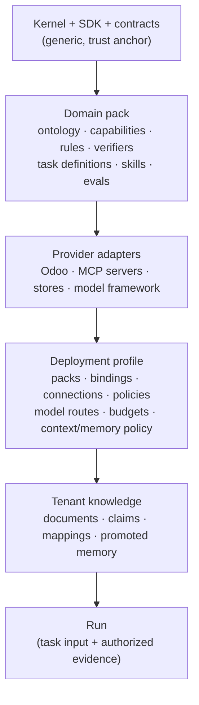

Why this ordering: rules and verifiers must be versioned artifacts that the kernel executes, not prose in prompts. AGENTS.md forbids divergent enforcement in prompts or UI. Tenant knowledge sits below the profile because it is untrusted until curated, and can never change policy.

### 2.2 G-criteria for high genericity

These criteria come from the 2026 platform references (control plane separated from execution, capability contracts with least-privilege adapters; §20) and from the project's own research 10. Each criterion has a fitness test so that "generic" is a measured property, not a claim.

| ID | Criterion | Fitness test | Status |
|---|---|---|---|
| G1 | The kernel contains no domain or provider types | import-linter: kernel ↛ domains/adapters/server | [I] |
| G2 | A new domain is a new pack only | Non-ERP fixture domain runs without ERP installed and without kernel edits (`tests/unit/kernel/conftest.py`, "notes" domain) | [I] |
| G3 | A new provider is a new adapter + manifest only | Second binding of an existing capability selected by connection; ambiguity rejected (`test_registry.py::test_two_connections_resolve_and_ambiguity_is_refused`) | [I] for native; [P] for MCP |
| G4 | A new task type is configuration + pack data | Adding a task definition (acceptance spec, capabilities) needs no kernel change | [P] (AR-01 acceptance spec) |
| G5 | Business rules are executable artifacts with one inventory | Every rule ID has positive, negative and missing-data tests; prompts reference IDs only | [I] (ADR 0009; `tests/integration/test_procurement_rules.py`, per-rule completeness not re-audited here) |
| G6 | Success is decided by domain verifiers, not the model | Run cannot reach `SUCCEEDED` without the task's acceptance spec passing | [Pa] (AR-01) |
| G7 | The reasoning loop is replaceable | Two AgentDriver implementations pass one conformance suite | [P] (one driver today) |
| G8 | Knowledge and memory backends are replaceable without semantic loss | Same competency fixtures pass on two backends; deletions and ACL preserved | [C] |
| G9 | Context and memory behavior are per-task policies | Changing the context budget or memory scopes in the profile changes behavior with no code change | [P] |
| G10 | Tenancy and authority are host-derived everywhere | Model- or event-supplied tenant, connection or credential IDs are rejected unless resolved in host scope | [I] (runs), [P] (triggers) |
| G11 | Every effect is traceable from goal to verified outcome | Evidence export answers research 03 competency questions for any run | [Pa] evidence export exists; competency-question test not located. Target test: the explanation projection of §5.6 (shared with Q5) |

### 2.3 What makes behavior *specific*

| Source | Mechanism | Example (procurement) | Status |
|---|---|---|---|
| Ontology + shapes | Domain normalizer builds typed facts; SHACL and other engines produce findings | PR-002 quantity = demand − stock | [I] (ADR 0009) |
| Capability contracts | Typed input/output; effect class (read/write/answer) | `procurement.purchase-order.create-draft.v1` | [I] |
| Task definitions | Acceptance spec, allowed capabilities, budgets, context and memory policy | "Draft PO for shortage" requires a verified draft PO or a verified no-op | [Pa] (ADR 0017 catalog today; acceptance specs and pack-owned definitions [P], G4) |
| Skills / playbooks | Versioned procedural guidance packaged in the pack and reviewed like code | "How to choose among approved offers" | [P] (only developer `ag-*` skills exist) |
| Tenant knowledge | Curated claims and documents, retrieved with ACL | Supplier contract terms | [C] (§9) |
| Policies | Deterministic permit/deny/approval | Writes over budget require approval | [I] |

---

## 3. Architecture overview

### 3.1 C4 level 1: system context

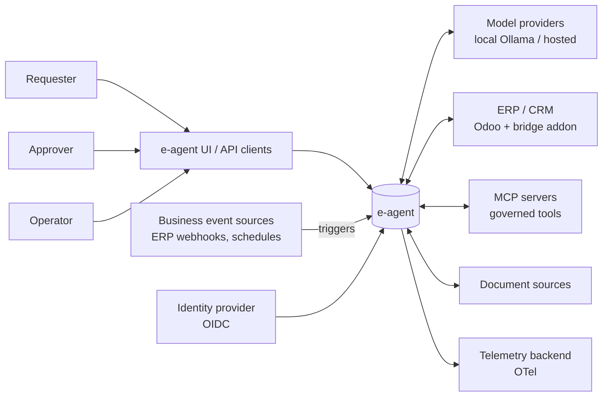

e-agent owns authority, state and evidence. External systems own their transactions. Models and MCP servers are untrusted participants whose output is data or proposals.

### 3.2 C4 level 2: containers

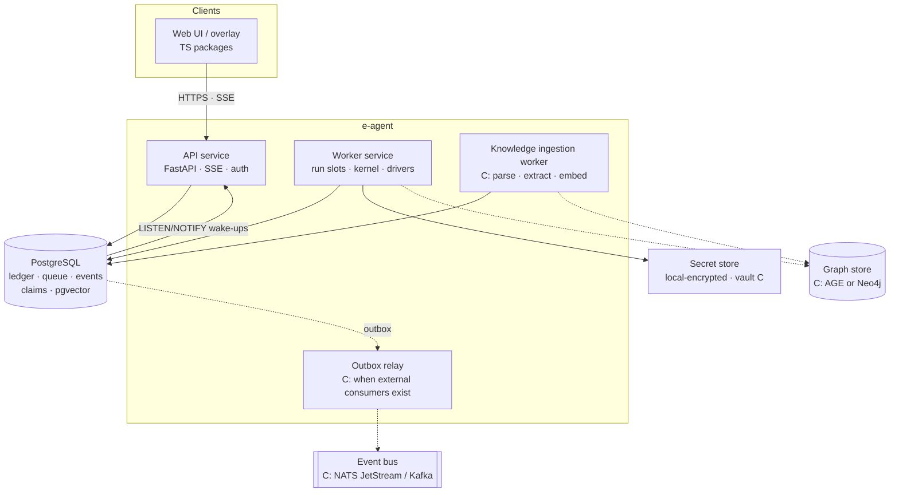

Status:
- **[I]** API service and PostgreSQL.
- **[Pa]** Worker service: it runs embedded in the API process with one run slot.
- **[C]** Ingestion worker, outbox relay, graph store, event bus and vault.

API and worker are the same distribution (`e-agent-server`) started in different roles. Separate services are a deployment choice, not a package split (HLD §4).

### 3.3 C4 level 3: kernel components after the SR-06 split

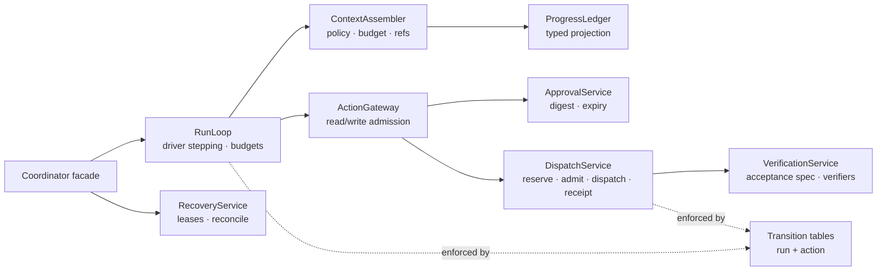

Status:
- **[I]** All of these responsibilities except ContextAssembler and ProgressLedger exist today inside `coordinator.py` (1509 lines).
- **[P]** Splitting them into these services, behind an unchanged facade. The ContextAssembler and ProgressLedger are new responsibilities. The run and action transition tables both exist.

---

## 4. Swappable runtime core

### 4.1 Decision

"Runtime core" splits into two parts.

**The trust anchor.** It decides *whether* something may happen and *what happened*. It is fixed kernel code.

**The execution machinery.** It decides *how* reasoning and execution are carried out. It is replaceable through SDK ports with conformance suites.

This keeps the earlier decision: no graph runtime in the kernel, and LangGraph only as a possible driver adapter (ADR candidate C6). It also meets the requirement that the runtime be changeable.

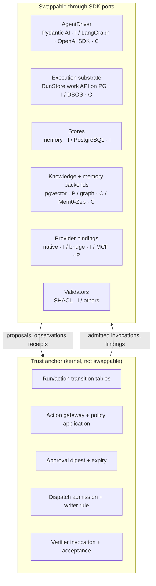

### 4.2 Seams and their contracts

| Seam | Port (location) | Swap rule | Conformance |
|---|---|---|---|
| Reasoning loop | `AgentDriver.advance(ctx, DriverInput) -> DriverStep` (`sdk/ports.py`) | Effectful tools must be deferred to the kernel (`CallDeferred`-equivalent); continuation is opaque, versioned and has no hidden reasoning | Driver conformance suite [P] (scripted driver + Pydantic AI driver) |
| Execution substrate | `RunStore.enqueue_work/claim_work/renew_work/finish_work/work_scope` (`sdk/store.py`) | Extract a separate `WorkQueue` port only when a second implementation exists | `tests/conformance/test_run_store.py` [I] |
| Durable engine | Wraps the substrate; never owns write retry | Ledger stays authoritative; an ambiguous write is never retried automatically (ADR 0003) | Fault-injection matrix [C] |
| Stores | `RunStore` | Memory store for tests; PG for durability | Store conformance [I] |
| Knowledge / memory | `EvidenceRetriever` [P] (HLD §7 name; today agent reads go through `ActionExecutor` read capabilities, `sdk/ports.py:115`, and verifier reads through `ScopedReader`, `sdk/ports.py:134`); `MemoryStore` [P] | Results always carry EvidenceRefs, scope and completeness | Competency fixtures [P] |
| Provider binding | `ActionExecutor`, `CapabilityProvider` | Bindings admitted through the manifest; the model never selects credentials | Binding-scope gate [I] |

### 4.3 Driver options

| Driver | When | Constraints |
|---|---|---|
| Pydantic AI 2.x [I] | Default (ADR 0001/0004) | Framework durability and `requires_approval` not used for business writes |
| LangGraph [C] | Pydantic AI fails conformance, or a concrete topology need appears | `interrupt()` restarts the whole node on resume, so effectful work must stay deferred to the kernel; its checkpointer holds continuation only, never authority |
| `pydantic_graph` [C] | A graph topology is needed inside the driver | Already in `uv.lock` as a Pydantic AI dependency; it stays inside the adapter |
| Thin direct-API loop [C] | Lowest overhead, cross-provider control | Must implement the same deferral and continuation rules |

The market evidence is that topology, not framework, dominates cost: about 2.1× on top of a 1.4× framework tax in a 2026 harness benchmark (agent-frameworks research §4.3). Prefer the thinnest topology that passes evals.

---

## 5. Traceable state

### 5.1 Principles

1. **State is typed and transitions are tabled.** Both run and action states change only through allowed transitions with compare-and-swap revisions. The action table exists (`contracts/action.py: ALLOWED_ACTION_TRANSITIONS`). The run table exists (`contracts/run.py: ALLOWED_RUN_TRANSITIONS`) and `_set_run_state` enforces it [I] (ADR 0018).
2. **The event log is the audit truth.** Every state change appends a typed, versioned `RunEvent` in the same short transaction [I]. Current-state rows stay authoritative for compare-and-swap concurrency control. Making those rows fully reconstructable from the log is a [P] target, tested by the U3 fitness row; it is not guaranteed today.
3. **Steps are first-class.** A *step* is one driver turn or one kernel action. Each step records its inputs (as refs), outputs, findings and status, so later steps and the model reason over results instead of re-deriving them.
4. **No hidden reasoning is persisted.** Model reasoning parts are stripped (ADR 0004) [I]. Explanations today are proposals, findings, a free-text `run.reason` and a typed `ReasonCode` [I]; structured rationale fields are proposed in §5.6 [P]. No `rationale` field exists in the contracts, the driver or the evidence export.

### 5.2 Run state machine (transition table implemented)

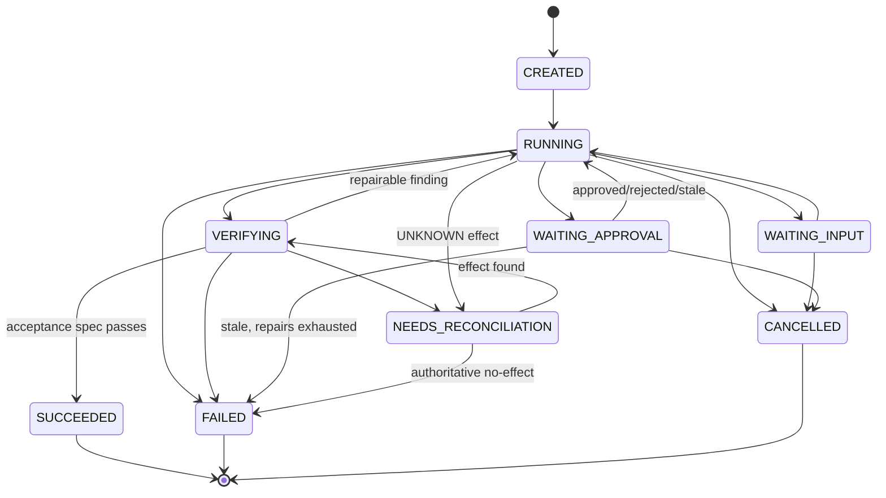

**This diagram is illustrative and incomplete.** The coordinator moves runs to `FAILED` from many states (13 direct `_set_run_state(..., RunState.FAILED)` calls), and a cancellation with unresolved effects stays in `NEEDS_RECONCILIATION` (MVP §7). The exact table was derived from the observed `_set_run_state` call sites and the crash-recovery rules, so that no existing flow breaks. It is implemented as `ALLOWED_RUN_TRANSITIONS` in `contracts/run.py` and enforced by `_check_run_transition` [I] (ADR 0018); the contract table is authoritative and this diagram is only a picture of it. The action state machine is unchanged from MVP design §7.

### 5.3 Data model (ledger, steps, knowledge)

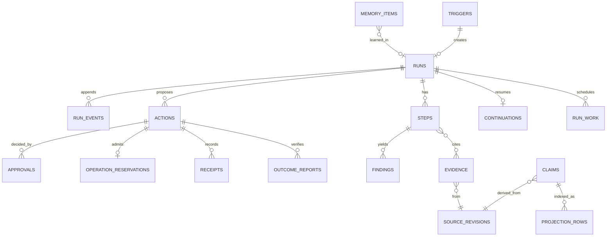

Status:
- **[I]** runs, run_events, actions, approvals, operation_reservations, receipts, outcome_reports, continuations, run_work, api_idempotency (migrations 0001–0003).
- **[P]** steps, findings (persisted; today they live in events and payloads), evidence (normalized table), triggers, writer_leases.
- **[C]** source_revisions, claims, projection_rows, memory_items (knowledge and memory phases).

Every table carries `tenant_id` with composite keys. Cross-tenant references are rejected by constraints (MVP §9).

### 5.4 Step record (proposed contract sketch)

```python
class StepKind(StrEnum):
    DRIVER_TURN = "driver_turn"
    READ = "read"
    VALIDATE = "validate"
    APPROVAL_WAIT = "approval_wait"
    DISPATCH = "dispatch"
    VERIFY = "verify"
    RECONCILE = "reconcile"

class StepStatus(StrEnum):
    STARTED = "started"; SUCCEEDED = "succeeded"; FAILED = "failed"
    BLOCKED = "blocked"; UNKNOWN = "unknown"; SKIPPED = "skipped"

class StepRecord(BaseModel):          # e_agent.contracts.step (proposed)
    model_config = ConfigDict(extra="forbid", frozen=True)
    schema_version: Literal["step.v1"] = "step.v1"
    tenant_id: str
    run_id: str
    step_id: str
    sequence: int                       # monotonic per run
    kind: StepKind
    status: StepStatus
    parent_step_id: str | None          # repair links to the step it repairs
    action_id: str | None
    input_refs: tuple[EvidenceRef, ...]  # no raw payloads
    output_ref: EvidenceRef | None
    finding_ids: tuple[str, ...]
    usage: StepUsage                     # tokens, calls, active seconds
    started_at: datetime
    finished_at: datetime | None
```

**Write path.** Step rows are written in the same short transaction as their `run_events`, under the run row lock. That is the same mechanism as event appends today (`store.py: _append`). There is no second, non-atomic write (MVP §9). Steps can therefore be checked against the event log, but the rows themselves are authoritative.

Why: today the agent's view of prior work is the framework message history. Step records make "what was tried, what failed and why" a typed, tenant-scoped fact that survives driver swaps and context compaction.

### 5.5 Audit integrity and attribution

The event log is the audit truth (§5.1), so its integrity and attribution are architecture, not operations detail.

| Property | Today | Target | Status |
|---|---|---|---|
| Append-only | Enforced by code only: `store.py` contains no UPDATE or DELETE on `run_events`, `approvals` or `receipts`. `runs` and `actions` are compare-and-swap state rows (`store.py:131`, `store.py:225`) whose history lives in `run_events` (§5.1) | The control and tenant roles from §13.1 receive INSERT and SELECT only on `run_events`, `approvals` and `receipts`; `runs`, `actions` and the queue keep UPDATE; DDL belongs to a migration role. A probe test tries an UPDATE on each of the three append-only tables with each application role and must fail | [I] code / [P] grants |
| Tamper evidence | None. The threat model (§4) accepts this residual for the MVP | Per-run hash chain: each event record carries the JCS digest of its predecessor; periodic anchoring of the latest digest to an external log | [C] trigger: external audit or compliance requirement, or multi-administrator production. Lifted at P5 at the earliest |
| Actor attribution | Every append stamps `RunEvent.actor` from the `current_actor` context variable (`sdk/store.py`, set with `actor_scope`; default `system:kernel`). The server sets `principal:<id>` for authenticated requests and `system:worker:<owner>` for claimed recovery and expiry work (`system:worker:startup` for startup recovery), and a work item runs under the principal it acts for. `correlation_id` is never set on events; only error responses mint one (`api.py`) | Every event carries `actor` (`principal:<id>`, `service:<id>` for triggers, `system:<role>` for kernel and worker) and the request's correlation id; the worker takes the correlation id from the work item | [I] actor / [P] correlation id (WP2) |
| Access audit | Reading a run, streaming it or exporting evidence appends nothing | An API access log (actor, run, operation, purpose, correlation id) for run reads, streams and evidence exports. Exports are deliberately not run events: an audit read must not advance the audited stream, reopen a terminal run (ADR 0007) or appear inside the next export | [P] |
| Control-plane audit | No connection, profile, policy or role tables exist (three migrations: ledger, `api_idempotency`, `run_work`). Configuration changes are file edits under git, so git history is the audit trail today | Control-plane audit table (who changed which profile, binding, policy bundle or role grant, with digests before and after) | [C] trigger: the first administrative mutation API |
| Failure classification | `RunRecord.reason_code` carries a typed `ReasonCode`; `evidence.classify()` reads it first and falls back to substring-matching the free-text `reason` for runs without a code. Buckets: blocked-by-design (a kernel guard refused before any effect), infrastructure-or-budget, otherwise failed; `VERIFICATION_FAILED` is `failed` because it follows a COMMITTED write (ADR 0018) | Derived from `ReasonCode` (§5.6) | [I] (ReasonCode, ADR 0018) |

Redaction rules for the export stay as in MVP §11. HLD §9 requires export authorization; today the export is tenant-scoped only (§13.2 closes this).

### 5.6 Explanation contract

Three readers need explanations: the approver before a write, the requester after the outcome and the auditor afterwards. Three rules apply:

1. **An explanation is never chain-of-thought.** Reasoning parts stay stripped (ADR 0004). What is persisted is structured, typed and checkable.
2. **Structured rationale is model-authored data.** It is validated, labelled as model-authored on the approval card (threat T9), and never a gate (§6.1). Only findings and verifiers move state.
3. **Facts in explanations come from the ledger**, never from the model's memory of them.

```python
class ProposalRationale(BaseModel):              # driver structured output (proposed)
    goal_ref: str                                  # task definition + acceptance item
    cited_evidence: tuple[EvidenceRef, ...]        # kernel checks each ref exists in this run
    rules_considered: tuple[str, ...]              # rule IDs; each must exist in the rule inventory
    alternatives: tuple[RejectedAlternative, ...]  # proposal digest + ReasonCode + one line
    summary: str                                   # <= 400 chars, rendered as "model-authored"

class ReasonCode(StrEnum):                         # beside free-text run.reason [I] (contracts/run.py; abridged here, the full set has 17 members)
    VALIDATION_FAILED = "validation_failed"
    POLICY_DENIED = "policy_denied"
    APPROVAL_REJECTED = "approval_rejected"
    APPROVAL_EXPIRED = "approval_expired"
    SURFACE_CHANGED = "surface_changed"
    BUDGET_EXHAUSTED = "budget_exhausted"
    PROVIDER_ERROR = "provider_error"
    CANCELLED = "cancelled"
    VERIFIED = "verified"
```

A rationale whose reference does not resolve, or whose rule ID is unknown, produces a `KERNEL-RATIONALE` finding; the proposal is still validated on its own merits. `_set_run_state(reason, code=...)` records the `reason_code` on the run [I]; the human text stays.

**Explanation projection [P].** A deterministic function over the event log renders goal → source facts (`read.recorded` refs) → validation (findings by rule ID) → proposal (digest, rationale) → approval (actor, policy version) → receipt → verified outcome. No model call is involved. It is the fitness test for G11 and Q5: the research 03 competency questions are answered from this projection. The approval card shows the canonical proposal first and the rationale second.

---

## 6. Multi-step reasoning and self-correction

### 6.1 Design

The evidence says LLMs do not reliably fix their own reasoning without external signals. Correction improves when feedback comes from execution, tools or verifiers ("Large Language Models Cannot Self-Correct Reasoning Yet"; a 2026 survey that tabulates intrinsic versus external feedback; §20). e-agent therefore corrects through **external, typed findings**:

| Finding source | Produced by | Example |
|---|---|---|
| Validation | Domain normalizer + rule engines | `PR-003 FAIL: offer B not approved` |
| Policy | PolicyEvaluator | `approval required: budget > limit` |
| Staleness | Kernel pre-dispatch check | `KERNEL-STALE: stock revision changed` |
| Tool / provider error | Executor (sanitized) | `KnownNoEffectError: supplier archived` |
| Verification | Domain verifier through authorized reads | `answer mismatch: expected 7, got 12` |
| Acceptance | Task acceptance spec (AR-01) | `required effect missing: draft PO` |
| Budget | Kernel | `repairs 2/2 used` |

Intrinsic self-critique ("reflect on your answer") may be used inside a driver for quality, but it is **never a gate**. Only kernel findings and verifiers move state.

### 6.2 Progress ledger

The kernel renders a compact, typed **progress ledger** for every driver turn. It is a projection of steps, actions and findings, not a new source of truth. The model may propose plan updates through a structured output. They are recorded as proposals (`plan.proposed`) and never become facts. Adding a plan-update variant to `DriverStep` changes the SDK port. It needs a plugin API version bump, an event-catalog schema snapshot update and an extension of the driver conformance suite (ADR C8).

```python
class ProgressLedger(BaseModel):      # rendered to the driver each turn (proposed)
    task: TaskSummary                  # goal, acceptance criteria (from task definition)
    plan: tuple[PlanItem, ...]         # model-proposed items with kernel-observed status
    completed: tuple[StepDigest, ...]  # recent steps: kind, status, short result ref
    open_findings: tuple[Finding, ...] # unresolved, with rule IDs and evidence refs
    pending: PendingState | None       # awaiting approval / input / reconciliation
    budgets: BudgetRemaining           # turns, reads, repairs, writes, tokens, seconds
    constraints: tuple[str, ...]       # policy obligations in plain text, by rule ID
```

The pattern is the "task ledger / progress ledger" structure used by orchestrator agents. Here the ledger is kernel-computed, so a driver swap or context compaction does not lose it.

### 6.3 Loop

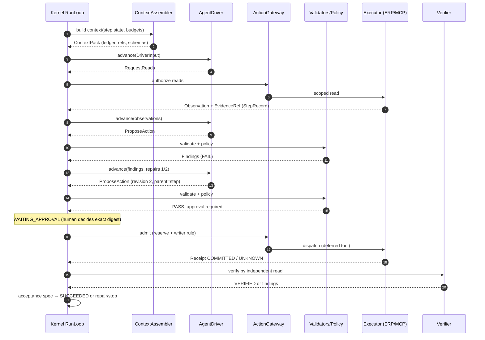

Repair limits come from the task definition and the profile (MVP §10 defaults). **Repeat detection [P]:** a proposal whose digest equals an already blocked revision in the same run gets a `KERNEL-REPEAT` finding without re-validation, and it counts against the repair budget. Today the kernel only short-circuits a repeated *verified* answer (`coordinator.py:744-753`). An exhausted budget stops new work. A possibly dispatched write still goes to reconciliation.

---

## 7. Context management

### 7.1 Ownership split

| Concern | Owner | Why |
|---|---|---|
| What may enter (authorization, redaction, scope, budget) | Kernel `ContextAssembler` [P] | Security boundary; must be framework-neutral |
| How it is rendered and compacted (messages, history processors) | Driver adapter | Framework-specific; Pydantic AI history processors / Harness stay inside the adapter |
| What is learned across runs | Memory service (§8) | Separate governance |

### 7.2 Context layers and budget

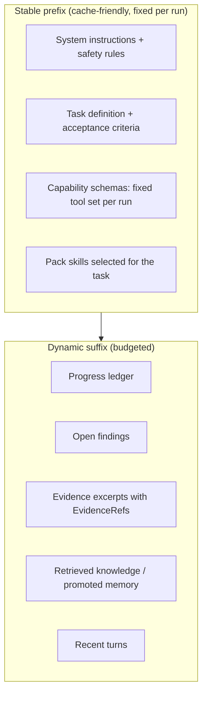

Rules:
1. **Fixed tool set per run.** Tool schemas are resolved at admission from the task definition and stay fixed for the whole run. Do not add or remove tools mid-run. This keeps the KV cache valid and avoids schema confusion; the Manus team names KV-cache hit rate as a key production metric (agent-frameworks research §4.3). A capability whose connection is not yet usable keeps its schema. The gateway answers a call to it with a `connect.required` finding and pauses for the delegated-connection flow (ADR 0013). When the connection appears, the call becomes admissible; no tool is added. (`connect.required` exists in the event catalog but the kernel does not emit it yet.)
2. **Clear before compacting.** Tool outputs dominate token use in agent traces (one 2026 preprint reports 70–80%). First, clear old tool results while keeping the call record and its `EvidenceRef`, so the agent can fetch them again. Second, cap output size per capability. Only third, summarize. Summarization is lossy and costs tokens.
3. **Budget per layer.** The profile sets token budgets per layer and per task. The assembler drops the lowest-priority dynamic items first and records what it dropped in the step usage.
4. **Typed state beats chat history.** The progress ledger and findings replace long message histories as the carrier of "what happened". Research 03 §8 proposes an ablation to confirm this (chat history vs typed state vs episodic recall).
5. **Untrusted content is fenced.** Retrieved documents, tool outputs and memory are wrapped as data with provenance. They can never change instructions, policy, budgets or tools.

### 7.3 Contract sketch

```python
class ContextPolicy(BaseModel):        # from task definition + profile (proposed)
    max_input_tokens: int
    layer_budgets: Mapping[ContextLayer, int]
    tool_result_retention_turns: int    # older results are cleared to refs
    max_tool_output_tokens: int
    summarize_after_tokens: int | None  # None = never summarize
    memory_scopes: tuple[MemoryScope, ...]

class ContextPack(BaseModel):
    stable: StablePrefix                # instructions, task, tool schemas, skills
    ledger: ProgressLedger
    evidence: tuple[EvidenceExcerpt, ...]   # each with EvidenceRef + trust class
    memory: tuple[MemoryExcerpt, ...]
    dropped: tuple[DroppedItem, ...]    # for audit and re-fetch
```

The driver receives the `ContextPack` inside `DriverInput` and maps it to framework messages. Contracts never import framework types.

### 7.4 Rendering rules that protect resume (decided in ADR C9)

Pydantic AI resumes deferred writes from `message_history` plus `deferred_tool_results` (ADR 0004), so the persisted history must stay valid.

1. **The ledger and findings go into a dynamic suffix that is rebuilt every turn.** They are never written into the persisted continuation. Today the driver appends findings to the history as a new user prompt (`driver.py:297-309`). Per-turn ledgers would therefore accumulate stale copies in the continuation, so this behavior changes under C9.
2. **The stable prefix does not carry per-turn state.** Putting the ledger into system instructions would change the prefix every turn and defeat rule 1 of §7.2.
3. **Clearing preserves pairing.** Clearing an old tool result replaces its content with a stub plus its `EvidenceRef`. The tool-call/return pair and any deferred call ID stay intact, so a resume can still match `DeferredToolResults.calls`.
4. **Compaction runs only between resumable points.** It never runs while deferred calls are pending.

---

## 8. Memory

### 8.1 Four memory types mapped onto stores

This follows the CoALA split adopted in research 03 §8.

| Type | Content | Store | Write path | Status |
|---|---|---|---|---|
| Working | Current task state, plan, evidence in use | Run state + progress ledger + continuation | Kernel only | [I]/[P] |
| Episodic | What happened in past runs | Ledger: `run_events`, steps, outcomes, evidence | Kernel only; retrieval through `MemoryStore.search_episodes` | [I] data / [P] retrieval |
| Semantic | Accepted business facts and definitions | Knowledge claims (§9) | Curation pipeline, never directly from a run | [C] |
| Procedural | Skills, playbooks, tool-usage guidance | Versioned files in domain packs (Agent Skills-style `SKILL.md`) | Code review + release; never auto-promoted | [P] (`scripts/check_agent_skills.py` validates developer `ag-*` skills, not product playbooks) |

### 8.2 Learning path: candidate → promotion

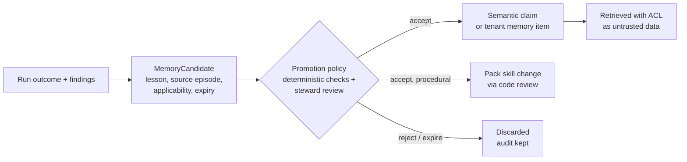

Rules:
- A memory candidate never affects any run until it is promoted.
- Promoted memory is retrieved as data with provenance, never as instructions.
- Deleting or revoking a source cascades to derived memory items (research 03 §11).
- Memory is partitioned by tenant, principal scope and policy revision; there is no global semantic cache.

### 8.3 Vendor options

| Option | Fit | Decision |
|---|---|---|
| Built-in (PG tables + pgvector + ledger) | Covers episodic and semantic retrieval with existing ACL and tenancy | Default [P] |
| Mem0 / Zep-Graphiti adapters | Personalization or temporal entity memory, if eval shows gain | [C] behind `MemoryStore`; published benchmarks conflict (LongMemEval vs LoCoMo, vendor-run), so evaluate on our own fixtures; avoid Kuzu-backed configurations (Kuzu archived) |
| Letta | Full agent runtime with self-managed memory | Rejected as a runtime: it would replace the kernel's control of context and state (lock-in) |
| Pydantic AI Harness memory | Framework session memory | Adapter-internal only; not canonical memory (ADR 0004 continuation hygiene) |

---

## 9. Knowledge and knowledge graph

### 9.1 Architecture

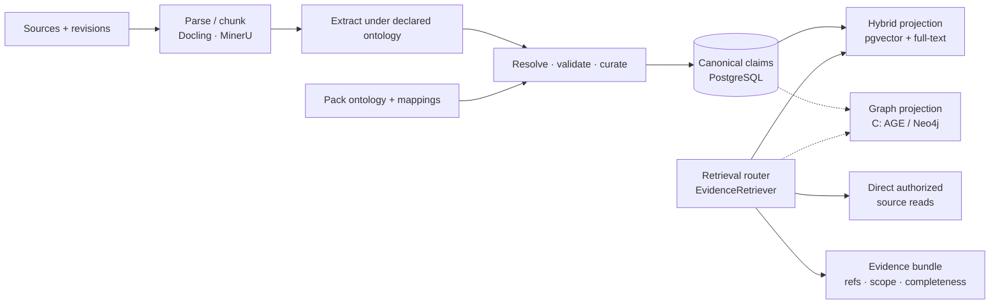

Principles (from research 03 and the KG research §H):
- **Claims are canonical; indexes are projections.** Projections are rebuildable. A backend swap needs semantic migration and ACL and deletion tests, not just reindexing.
- **Hybrid search first.** Contextual retrieval plus BM25 plus reranking gave the largest measured gains (−49% and −67% retrieval failures in Anthropic's study) at lower cost than a graph.
- **The graph is a targeted second stage**, introduced only for named multi-hop, relationship or temporal competency questions. Graph retrieval showed about 2.3× latency and lower accuracy on single-fact questions in the cited study.
- **Current transactional state comes from source systems** through direct authorized reads, not from the KG.
- **ACL is applied before content reaches the reranker or the model.** Graph traversal checks permissions on nodes, edges and intermediate paths (research 03 §10).
- **Generated queries are not executed raw.** SQL, Cypher and SPARQL use approved templates or AST validation, read-only credentials and cost limits.

### 9.2 Attachment through existing ports

The knowledge service is a new distribution, `e-agent-knowledge` [C], with a narrow public API. Its trigger is the first real ingestion or curation use case (HLD §7; research 10). The agent reaches knowledge only through `EvidenceRetriever` capabilities admitted like any other read, so retrieval is authorized, audited and budgeted. Graph and vector engines are adapters (`adapter-knowledge-pg` [C], `adapter-graph-age` or `adapter-graph-neo4j` [C]).

### 9.3 Graph engine choice (when triggered)

| Option | Pros | Cons | Use when |
|---|---|---|---|
| Apache AGE in the same PostgreSQL | One operational system; transactions with claims | openCypher subset; extension upgrades tied to the PG major version (CI runs PG 16 today, so check AGE support for the deployed version) | Moderate graph needs, ops simplicity |
| Neo4j + neo4j-graphrag | Mature GraphRAG tooling, native vector index | Separate system; Enterprise licence for HA | Heavy traversal / analytics |
| RDF store + SHACL/SPARQL | Standards-based semantics and inference | Steeper tooling and operations | Ontology exchange or inference required by competency questions |

The decision is recorded in an ADR when the trigger fires. Do not adopt Kuzu (archived) or a store with SSPL or non-commercial licences without legal review (KG research §H).

---

## 10. Integration

### 10.1 Model: domain → capability → binding → connection

This is unchanged from HLD §5 and is the core of explicit integration. The model may propose a target; only host resolution selects a binding and connection.

| Adapter kind | Example | Status | Notes |
|---|---|---|---|
| Native client | Odoo JSON-2 executor | [I] | `adapters/odoo/executor.py` |
| Transactional bridge | `addons/e_agent_bridge` | [I] | Provider-side uniqueness and reconciliation reads (ADR 0005) |
| MCP client binding | Governed MCP server tools mapped to capability contracts | [P] | See §10.2 |
| Analytics | BigQuery read-only, parameterized | [C] | ADR 0001 scope, I12 |
| e-agent as MCP/A2A server | Expose task definitions to other agents | [C] | Only with a concrete consumer; same admission and approval |

### 10.2 MCP as a binding type (proposed)

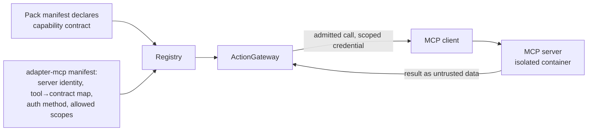

Rules:
- An MCP tool is reachable only when mapped to a capability contract with an effect class. Unmapped tools are invisible.
- The tool list is filtered per principal and fixed per run (§7.2).
- MCP write tools follow the same deferral, approval, admission and reconciliation as native writes.
- Credentials come from the connection and `SecretStore`, never from the model.
- MCP authorization has changed across 2026 revisions, and secondary sources disagree on what is mandatory. Verify against the official specification before implementation, and treat server auth as e-agent's responsibility in any case.

### 10.3 Inbound integration

Business events (ERP webhooks, schedules) create runs through the trigger path in §11.2. They never call executors directly.

---

## 11. Event-driven architecture

### 11.1 Event flows

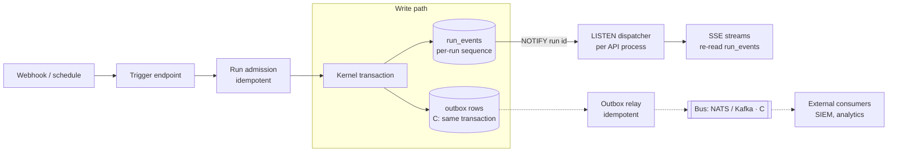

Status:
- **[I]** `run_events`, and NOTIFY on append (`store.py:101`).
- **[Pa]** SSE: it polls every 200 ms because no LISTEN consumer exists (review SR-02).
- **[P]** LISTEN dispatcher, trigger endpoint.
- **[C]** Outbox, relay and bus, added only when a named external consumer exists (AGENTS.md: no unused abstractions).

| Need | Transport |
|---|---|
| Intra-cluster wake-ups (IDs only, ≤ 8000-byte payload, not durable) | PG LISTEN/NOTIFY |
| Durable fan-out to a few internal consumers | Outbox + polling relay, or NATS JetStream |
| High-volume external streaming with retention | Outbox → Kafka/Redpanda |
| Token text deltas across processes | **Combined mode** (`serve` with embedded worker): the in-process `PublicTextBus`, as today. **Split mode** (separate `e-agent worker`): the worker publishes coalesced deltas on a dedicated NOTIFY channel (100–250 ms batches, ≤ 8 KB, transient, best-effort) to API processes. `message.final` stays the durable source, and snapshot/reset frames cover gaps. NOTIFY volume is measured in the load harness |

### 11.2 Event-triggered runs (proposed rules)

A trigger is a business event that asks e-agent to start a task. Triggers must not open a path around the core invariants:

1. **Trusted service principal.** The trigger source authenticates as a configured service principal with explicit roles. Tenant and connection come from the trigger configuration, never from the payload.
2. **Idempotency.** Key = `(tenant_id, trigger_id, source_event_id)`. A replayed event returns the existing run.
3. **Untrusted payload.** The event body is task input and evidence, handled like user text. It cannot carry approvals, budgets or policy.
4. **Same approval.** Writes still need policy evaluation and, where required, human approval by an authorized approver. The service principal cannot approve its own run's writes.
5. **Rate and budget limits** per trigger and tenant, enforced at admission.
6. **Approval reachability.** Approval expires (MVP §10 default 15 minutes), and `approval_ttl` is a single coordinator setting today (`coordinator.py:119`). Before WP1, expiry was checked only when a decision arrived and no sweeper existed, so a run started by a webhook at night stayed in `WAITING_APPROVAL` indefinitely. An **expiry sweeper [I]** (fenced `expire` work, ADR 0019) now runs every `APPROVAL_SWEEP_SECONDS = 30`: it enqueues `expire` work, and the worker re-checks the TTL under the claim, moves the pending action to `BLOCKED` and fails the run with `APPROVAL_EXPIRED`. Repairing the run per the task definition instead of failing it stays [P]. Triggered tasks that need approval therefore also need two things: an approver notification and inbox path [P], which is out of scope in ADR 0017 today, and an approval TTL set per task definition [P]. **Until both exist, triggers are limited to read/answer tasks and to writes that policy permits without approval.**

```python
class TriggerSpec(BaseModel):          # profile-declared (proposed)
    trigger_id: str
    tenant_id: str
    service_principal: str
    task_definition_id: str
    source: Literal["webhook", "schedule"]
    signature: WebhookSignatureRef | None   # HMAC secret by reference
    max_runs_per_minute: int
```

---

## 12. Scale and concurrency

### 12.1 Deployment shape

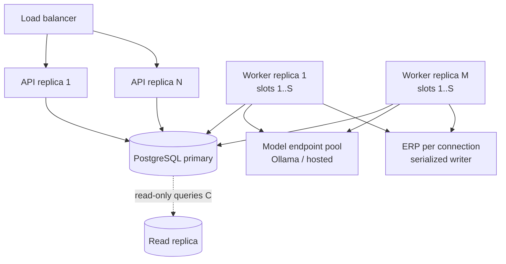

### 12.2 Mechanisms (review SR-01..SR-05)

| Mechanism | Purpose | Status |
|---|---|---|
| Bounded run slots per worker (`asyncio` semaphore / task group), per-tenant cap in the claim query | Concurrency with fairness; slot count is bounded by model concurrency and pool size, not CPU (for local Ollama, by its parallel-request setting) | [P] (1 slot today) |
| Waits release slots | A claim ends when the run reaches `WAITING_APPROVAL`/`WAITING_INPUT` (`store.wait_for_approval` is an atomic state + continuation write, `store.py:262`). An approval decision enqueues new work (`api.py:574`); an input is accepted together with its work item atomically (`coordinator.py:456`, `accept_input(enqueue=True)`). Human waits therefore do not hold slots | [I] |
| Admission control at enqueue | Per-tenant queue-depth limit with an explicit queued or rejected response, checked in the same transaction as the enqueue so concurrent submissions cannot race past it; per-tenant token quotas in the profile | [P] |
| Model-call retry policy | Retries on model 429/5xx are allowed because they have no side effect, but they consume the active-time and token budget. They are a different category from write retries, which are never automatic | [P] (policy to be written down) |
| Shared-singleton audit before slots > 1 | The driver keys `_RunState` by `run_id`; work claim is a `ContextVar`; still check the executor client, text bus and caches | [P] |
| LISTEN dispatcher + slow fallback poll | Streaming load independent of idle viewers | [P] |
| Connection-level write admission: no new write while a `RESERVED`, `DISPATCHING` or `UNKNOWN` action exists on that connection (`reserve_operation` raises `ConnectionBusy`; the run fails with `CONNECTION_BUSY`) | Restores the serialized-writer backstop even if a lock or lease is lost mid-call. `RESERVED` is in the set because the reservation commits before the action reaches `DISPATCHING` | [I] (ADR 0020; lease still [P]) |
| Durable writer lease replacing the session advisory lock; TTL > provider timeout + margin | Stops pool connections being pinned during ERP I/O | [P] |
| Separate pools per role (worker: slots + heartbeat + LISTEN; API) | Avoid starvation | [P] |
| `e-agent worker` and `serve --no-worker` | Scale API and workers independently | [P] |
| Cross-process cancel via persisted intent observed by the executing worker; dispatch stays non-cancellable | Correct cancel in multi-process deployments | [P] |
| `run_events` partitioning by time; retention jobs | Long-term volume | [C] |

### 12.3 Capacity evidence

No throughput targets are stated until a baseline exists. The load harness uses the scripted driver and a fake ERP with injectable latency.

It measures:
- runs completed per minute;
- queue wait;
- time from event append to SSE delivery;
- PG pool wait;
- streaming queries per second;
- writer-lease wait;
- NOTIFY volume and queue-lock waits (split-mode text deltas);
- safety counters: duplicate dispatches (must be 0), unresolved UNKNOWN actions, fence rejections.

Results are labelled fixture/infrastructure evidence, never live qualification.

### 12.4 Concurrent request semantics

| Situation | Behavior | Status |
|---|---|---|
| Two creates by the same actor with the same `Idempotency-Key` and payload | One run; the second call returns the existing run. The key is scoped per actor (`PRIMARY KEY (tenant_id, actor_id, idem_key)`), so two actors sharing a key make two runs | [I] (`migrations/0002_api_idempotency.sql`; header required, `api.py:455`) |
| Same actor and key, different payload | 409 CONFLICT | [I] (`0002` header comment) |
| Two approvers decide the same action | Compare-and-swap on `expected_run_revision`: the first wins, the second gets 409 (`coordinator.py:971`) | [I] |
| Decision for an action no longer pending, or with a stale digest | 409 CONFLICT / APPROVAL_STALE (`coordinator.py:974-979`) | [I] |
| Input while the run is not `WAITING_INPUT` or the revision moved | 409 (`api.py:589`) | [I] |
| Request on another tenant's run | 404 with a FORBIDDEN body; absent and foreign look the same (`api.py:510`) | [I] |
| Many requests from one principal | No per-principal request limit; only budget exhaustion returns 429 (`api.py:58`) | [P] token-bucket limits per principal and per tenant at the API, separate from run budgets |
| Snapshot or export of a long run | `list_events(after_sequence, limit)` pages events; the API reads `EVENT_PAGE = 500` per call (the events endpoint `limit` ceiling is 1000) and evidence export reads `EVIDENCE_PAGE = 1000`; `build_evidence` still holds all events, actions, approvals and receipts in memory | [I] paged (EVENT_PAGE 500, ceiling 1000); [P] streamed evidence export; per-run event cap enforced by budgets |
| Many SSE viewers of one run | One database poll per viewer (SR-02) | [P] LISTEN dispatcher (C2) plus a per-principal connection cap |
| Decide racing cancel | Not analyzed in this review | [I] the run transition table exists (`ALLOWED_RUN_TRANSITIONS`, ADR 0018); [P] the decide/cancel race analysis |

---

## 13. Multi-domain production

| Concern | Design | Status |
|---|---|---|
| Domain isolation | Bounded contexts inside packs are import-independent (ADR 0002); cross-domain workflows live in application modules over public capabilities | [I] |
| Tenancy | `tenant_id` on every row with composite keys; host-derived scope; add PostgreSQL row-level security as defense in depth with a per-request `SET LOCAL` tenant | [I] keys / [P] RLS |
| Identity | OIDC for users; service principals for triggers; local session mode only on loopback | [P] (local mode [I]) |
| Secrets | `SecretStore` port: local envelope-encrypted [I]; vault / cloud KMS adapters [C] | [I]/[C] |
| Policy | Deterministic `PolicyEvaluator`; policy version in approval digests (`kernel/approval.py:59`). Today one hardcoded `DefaultPolicy` (`version = "policy-mvp-1"`); the profile has no policy-bundle setting | [I] version in digest / [P] versioned bundles |
| Observability | OpenTelemetry with content capture off by default (ADR 0008). GenAI semantic conventions are still at Development status (moved to a separate repository in June 2026), so pin the convention version. No OpenTelemetry, structured-logging or `EventObserver` code exists in the tree yet | [P] (ADR accepted, not implemented) |
| Evals | Deterministic scenarios plus live trials (ADR 0010); every domain pack ships scenarios and competency fixtures; evals run in CI on fixtures | [I] ERP / [P] per-pack contract |
| Release | Approved artifact inventory with digests; drain or keep compatible continuations on upgrade (HLD §8, MVP §6). New: pack skill and task-definition versions are recorded per run in evidence export; revocation still overrides pins; a pack release requires its ADR 0010 scenarios to pass in CI. Skills are not part of the approval digest: they shape the proposal, not the facts being approved | [I] inventory / [P] drain tooling, per-run skill provenance |
| Data lifecycle | Retention for evidence, continuations and memory; deletion cascades through projections | [P] |

### 13.1 Tenant isolation options

| Option | When | Caveats |
|---|---|---|
| Shared schema + `tenant_id` keys [I] + RLS [P] (default) | Most deployments | RLS is defense in depth; host-derived scoping stays primary. **It needs two database roles.** Several store paths cross tenants by design: `claim_work(owner)` scans every tenant's work, `list_unfinished_runs()` takes no tenant, the LISTEN dispatcher serves all tenants, and `writer_lock` runs `_fence` on an autocommit connection, where `SET LOCAL` has no effect. Under tenant-scoped RLS those paths would break, or would push someone to give the app role `BYPASSRLS` and make RLS pointless. Use (1) a **control role** with narrow policies, limited to claim, recovery, fencing and LISTEN; and (2) a **tenant role** for all other work, with the tenant set by `SET LOCAL` from the claim or session inside each transaction. Autocommit paths use the control role or set the tenant explicitly |
| Schema-per-tenant [C] | Contractual isolation or per-tenant migrations | Migration fan-out; the work queue and the LISTEN channel must span schemas or move to a shared control schema |
| Database-per-tenant [C] | Data residency, strict isolation, noisy neighbours | Breaks the single `run_work` queue and LISTEN channel. This is a deployment-topology change (a worker pool per database or a control plane routing tenants), not a configuration flag |

Adding a domain means creating a pack distribution with ontology, contracts, rules, verifiers, task definitions, skills and eval scenarios. Then add adapter bindings, enable the pack and bindings in the profile, and run the G-criteria gates (§2.2).

### 13.2 Authorization model

**Today [I].** Self-approval is refused unless `operator.allow_self_approval` is set (ADR 0019) [I]; the fixture profile sets it, `profiles/live.example.json` keeps the forbidden default, and `/health/ready` reports `self_approval_allowed`. Two static roles, `requester` and `approver` (`kernel/policy.py:9-10`). `DefaultPolicy` permits when the principal has the requester role and the connection is in `resource_scope`, and requires approval exactly when the effect is a write (`policy.py:13-31`). `decide` requires the approver role (`coordinator.py:969`); input requires the principal to be the requester (`api.py:587`); run reads, the stream and the evidence export are tenant-scoped only (`api.py:472`, `api.py:510`, `api.py:615`). Roles come from the profile's operator in local mode (`bootstrap.py:161-166`). Reads are the odd one out: any tenant member can read any run and export its evidence, while HLD §9 requires export authorization.

**Target [P].** Extend this model; do not replace it with an external policy engine.

```python
class AuthorizationBundle(BaseModel):            # profile-declared, versioned (proposed)
    role_mappings: tuple[RoleMapping, ...]         # IdP claim or group -> e-agent role
    task_grants: tuple[TaskGrant, ...]             # role -> task definition IDs
    capability_grants: tuple[CapabilityGrant, ...] # role -> capability IDs and effect kinds
    approval_scopes: tuple[ApprovalScope, ...]     # role -> domains, connections, limits, daily cap
    visibility: VisibilityPolicy                   # requester | approvers in scope | operator | auditor
    self_approval: Literal["forbidden", "profile_flag"]  # profile_flag: operator.allow_self_approval (ADR 0019)
```

Rules:

1. **Authority is host-derived** (G10). The bundle version joins the policy version in the approval digest, so a grant change after a proposal makes the approval stale, as a surface change does today.
2. **No self-approval in production.** `decide` rejects `actor.principal_id == run.requester_id` unless the profile sets `operator.allow_self_approval` [I] (ADR 0019; HLD §3 deliberately lets one demo operator hold both roles). Approval scopes and run visibility stay [P]. This generalizes §11.2 rule 4: a service principal can never approve.
3. **Approval scope.** An approver decides only actions whose domain, connection and limits fall inside their scope. Out of scope is FORBIDDEN and logged.
4. **Run visibility.** Requester, approvers whose scope covers the pending action, operators (support) and auditors (read-only evidence). Everyone else gets 404, like a foreign tenant. This closes the HLD §9 export-authorization baseline.
5. **Enforcement lives in the kernel and the policy evaluator**, not in HTTP handlers. The API maps identity and nothing more.

Rejected or deferred: an external policy decision point (OPA, Cedar) [C]. Trigger: a tenant requires externally managed policies, or more than one application must share them. Until then a versioned in-profile bundle keeps the no-unused-abstraction rule.

---

## 14. Technology and database decisions

| Layer | Choice | Why | Rejected / deferred (trigger) |
|---|---|---|---|
| Language / tooling | Python 3.12+, uv workspace, ruff, mypy strict, import-linter, pytest | Existing baseline; architecture gates in CI | — |
| HTTP | FastAPI + uvicorn (Granian optional) | Already confined to `e_agent.server`; the bottleneck is model/ERP latency and the worker, not routing; FastAPI 0.143.0 released 2026-10-08 | Litestar: last release 2.24.0 on 2026-06-11, msgspec gain moot with Pydantic contracts. Revisit if profiling after the review's P0 fixes shows HTTP overhead is significant |
| Contracts | Pydantic v2 models, JSON Schema snapshots, JCS digests | Shared Python/TS golden vectors (ADR 0006) | — |
| Agent framework | Pydantic AI 2.x behind AgentDriver | Typed, deferred tools, thin topology | LangGraph as a driver adapter only (ADR candidate C6) |
| Model serving | Ollama locally (default); hosted providers through Pydantic AI providers. LiteLLM is an explicit, opt-in provider behind a loopback proxy (ADR 0021, Proposed); no LiteLLM-routed model is qualified | ADR 0001, ADR 0021 | A model gateway (routing, quotas) when multiple tenants share providers [C] |
| System of record | PostgreSQL (CI runs 16; target the latest supported major in an ADR) via psycopg 3 async + pool | Transactions for ledger, queue, events; one operational system | — |
| Work queue | PG `run_work` with `SKIP LOCKED`, leases, fencing | No extra infrastructure; fenced recovery exists | DBOS [C] if ADR 0003's trigger fires; Temporal [C] if multi-day orchestration across services is required |
| Streaming | SSE + LISTEN/NOTIFY wake-ups | ADR 0007 resume semantics | WebSockets: no bidirectional need |
| Vectors | pgvector ≥ 0.8.2 (CVE-2026-3172), pgvectorscale optional | Same database, same ACL and transactions | Qdrant/Milvus [C] when measured recall/latency or volume exceeds PG on our fixtures |
| Lexical search | PostgreSQL full-text search | Built-in | A BM25 extension [C] after a licence check (`ts_rank` is not BM25) |
| Graph | None until triggered | KG research: graph only for named multi-hop questions | AGE / Neo4j / RDF store (§9.3) |
| Validation | pySHACL adapter + domain normalizer | ADR 0009 rule inventory | — |
| Messaging | None until a consumer exists | Avoid unused abstractions | NATS JetStream / Kafka via outbox [C] |
| Secrets | Local envelope-encrypted store | MVP | Vault / KMS adapters [C] |
| Telemetry | OpenTelemetry, pinned GenAI conventions [P] | Vendor-neutral; ADR 0008 accepted, nothing implemented | — |
| UI | TS workspace: client, ui-core, tokens, ui-react, components, layouts, overlay element | ADR 0011/0015/0016 | — |
| Parsing (knowledge) | Docling (MIT) default, MinerU for hard scans | KG research §H | Marker (licence threshold) |
| Embeddings | Qwen3-Embedding (Apache-2.0, multilingual incl. Vietnamese) self-hosted, or a managed provider | KG research §D | Licence-restricted models |

---

## 15. Target repository structure

Legend: `[I]` exists, `[P]` proposed (created when implemented), `[C]` created only when its trigger fires. Per AGENTS.md, no empty future packages are created.

The layout is `[I]` since roadmap Phase 1 (2026-10-13). All Python code is one layer-grouped tree under `src/e_agent/` with no repeated folder names, and each distribution keeps its own build config in `dists/<name>/`, so the 10 distributions are still released independently; see the [Phase 1 plan](../plans/2026-10-12-phase1-structure-refactor.md). A new distribution adds `src/e_agent/<part>/`, `dists/<name>/pyproject.toml` and `tests/unit/<part>/`.

```text
e-agent/
├── AGENTS.md · CLAUDE.md · README.md · pyproject.toml (uv workspace)       [I]
├── src/e_agent/                    all Python product code (PEP 420)          [I]
│   ├── contracts/                  e_agent.contracts — portable records      [I]
│   │   ├── action.py run.py events.py evidence.py ...                        [I]
│   │   ├── step.py                 StepRecord, Finding persistence            [P]
│   │   ├── context.py              + ContextPolicy, ContextPack               [I]/[P]
│   │   ├── task.py                 TaskDefinition, AcceptanceSpec             [P]
│   │   └── trigger.py              TriggerSpec                                [P]
│   ├── sdk/                        e_agent.sdk — ports, manifests            [I]
│   │   ├── ports.py                AgentDriver, Executor, ScopedReader, ...   [I]
│   │   ├── retriever.py            EvidenceRetriever port                     [P]
│   │   ├── store.py                RunStore (+ work API = substrate seam)     [I]
│   │   └── memory.py               MemoryStore port                           [P]
│   ├── kernel/                     e_agent.kernel — trust anchor             [I]
│   │   ├── coordinator.py          facade (today: everything)                 [I]
│   │   ├── transitions.py          run + action transition enforcement        [P]
│   │   ├── run_loop.py             driver stepping, budgets                   [P]
│   │   ├── context.py              ContextAssembler                           [P]
│   │   ├── ledger.py               ProgressLedger projection                  [P]
│   │   ├── gateway.py              read/write admission                       [P]
│   │   ├── dispatch.py             reserve, writer rule, lease, receipt       [P]
│   │   ├── verification.py         acceptance spec, verifiers                 [P]
│   │   ├── recovery.py             leases, reconcile                          [P]
│   │   └── approval.py policy.py registry.py discovery.py ...                [I]
│   ├── erp/                        e_agent.erp — bounded contexts            [I]
│   │   ├── procurement/            api, normalizer, rules, shapes, ontology,  [I]
│   │   │                           verifier, answers
│   │   ├── procurement/tasks/      task definitions + acceptance specs        [P]
│   │   ├── procurement/skills/     SKILL.md playbooks                         [P]
│   │   ├── inventory/ sales/ crm/ receivables/                                [I]
│   │   └── testing/                fake ERP, scripted driver, scenarios       [I]
│   ├── analytics/                  e_agent.analytics                          [C]
│   ├── knowledge/                  e_agent.knowledge — claims, router API     [C]
│   ├── adapters/                   e_agent.adapters.* (namespace)             [I]
│   │   ├── pydantic_ai/            AgentDriver: Pydantic AI 2.x               [I]
│   │   ├── langgraph/              AgentDriver alternative                    [C]
│   │   ├── postgres/               RunStore, migrations                       [I]
│   │   ├── shacl/                  validation engine                          [I]
│   │   ├── odoo/                   ERP executor + reconciliation              [I]
│   │   ├── secretstore_local/      SecretStore                                [I]
│   │   ├── mcp/                    MCP client binding                         [P]
│   │   ├── knowledge_pg/           pgvector + full-text projection            [C]
│   │   ├── graph_age/ | graph_neo4j/  graph projection                        [C]
│   │   ├── memory_<vendor>/        MemoryStore over Mem0 / Zep                [C]
│   │   ├── durable_dbos/           substrate wrapper                          [C]
│   │   └── bigquery/               analytics executor                         [C]
│   └── server/                     e_agent.server — composition root          [I]
│       ├── bootstrap.py            wiring, profile → plugins → registry       [I]
│       ├── api.py                  FastAPI routes, SSE                        [I]
│       ├── cli.py                  demo, migrate, recover, serve              [I]
│       ├── worker.py               `e-agent worker` role, run slots           [P]
│       ├── streaming.py            LISTEN dispatcher + SSE fan-out            [P]
│       ├── triggers.py             webhook/schedule → run admission           [P]
│       └── profiles/               non-secret profiles                        [I]
├── dists/                          one build config per distribution          [I]
│   ├── <distribution>/pyproject.toml   name, version, deps, entry points      [I]
│   └── _hooks/src_tree.py          wheel takes src/e_agent/<part>; editable   [I]
│                                   installs import from src/; no sdists
├── addons/e_agent_bridge/          Odoo 19 addon                              [I]
├── ui/                             TS workspace (packages/*, apps/web ...)    [I]
├── tests/
│   ├── unit/<part>/                mirrors src/e_agent/                       [I]
│   ├── conformance/                run store, agent skills, repo layout       [I]
│   │   ├── test_driver.py          driver conformance suite                   [P]
│   │   └── test_memory_store.py    memory port conformance                    [P]
│   ├── integration/                rules, recovery, Odoo live                 [I]
│   ├── harness/                    development harness                        [I]
│   ├── load/                       fixture load harness                       [P]
│   └── replays/                    recorded model replays                     [I]
├── scripts/                        wheels, inventory, qualification, mover   [I]
├── tools/harness/ · harness/       development harness and its state          [I]
├── docs/                           roadmap, design/, plans/, specs/, adr/,    [I]
│                                   handoffs/, reviews/, runbooks/
└── research/ · archive/            source research, history (read-only)       [I]
```

---

## 16. Module map (where to look)

Paths are relative to `src/e_agent/`.

| Architecture element | Location today | After split |
|---|---|---|
| Run/action state, transitions | `contracts/{run,action}.py`; `kernel/coordinator.py` (`_set_run_state`, `_transition`) | `kernel/transitions.py` |
| Driver loop and budgets | `kernel/coordinator.py` (`_drive`) | `kernel/run_loop.py` |
| Approval | `kernel/approval.py`, `contracts/digest.py` | unchanged |
| Dispatch and writer serialization | `kernel/coordinator.py:1041-1140`; `adapters/postgres/store.py: writer_lock` | `kernel/dispatch.py` + lease rows |
| Work queue / substrate | `sdk/store.py` (work API), `adapters/postgres/store.py: claim_work` | unchanged seam |
| Worker loop | `server/api.py: ApiState.worker` | `server/worker.py` |
| SSE | `server/api.py: stream` | `server/streaming.py` |
| Plugin discovery/admission | `sdk/discovery.py`, `kernel/discovery.py`, `kernel/registry.py` | unchanged |
| Driver adapter | `adapters/pydantic_ai/driver.py` | + context rendering from `ContextPack` |
| Domain rules and verifiers | `erp/procurement/{rules,shapes,validation.py,verifier.py}` | + `tasks/`, `skills/` |
| Task catalog | `server/api.py: TaskTemplate` (ADR 0017) | backed by `contracts/task.py` definitions |
| Authorization | `kernel/policy.py: DefaultPolicy` (two roles); `server/api.py` requester and tenant checks | `contracts/authz.py: AuthorizationBundle`; checks in `kernel/policy.py` and `kernel/approval.py` (C16) |
| Reason codes and rationale | `contracts/run.py: reason` (free text) and `ReasonCode` / `RunRecord.reason_code` [I]; no rationale field | `contracts/action.py: ProposalRationale` (C18) |
| Explanation projection and evidence | `kernel/evidence.py: build_evidence, classify` | `kernel/explain.py` projection over `run_events`; `classify` derived from `ReasonCode` (C17/C18) |
| Import boundaries | root `pyproject.toml [tool.importlinter]` | + contracts for new kernel modules and adapters |

---

## 17. ADR candidates

| ID | Decision | Refines |
|---|---|---|
| C1 | Concurrent run slots per worker with per-tenant fairness; admission control at enqueue (queue depth checked in the enqueue transaction, token quotas); model-call retry policy (§12.2) | ADR 0003, 0014 |
| C2 | LISTEN dispatcher for streams; text deltas in-process (combined mode) or coalesced NOTIFY from workers (split mode) | ADR 0007 |
| C3 | Connection-level write admission rule + durable writer lease (TTL > provider timeout) — admission rule merged, lease pending | ADR 0003, 0014; MVP §9 |
| C4 | API and worker process roles | HLD §4 |
| C5 | HTTP framework stays FastAPI; revisit trigger | — |
| C6 | Run transition table; no graph runtime in the kernel; LangGraph only as a driver adapter — WP1 part merged | ADR 0004; MVP §7 |
| C7 | Swappable-runtime boundary: trust anchor vs ports (§4) | HLD §6 |
| C8 | Step records and progress ledger as kernel projections; plan updates are proposals; `KERNEL-REPEAT` finding for repeated blocked proposals (§6) | MVP §4, §7 |
| C9 | ContextAssembler ownership split and context rules (§7) | ADR 0004 |
| C10 | Memory model, promotion path and `MemoryStore` port (§8) | HLD §7 |
| C11 | Task definitions with acceptance specs (AR-01) as the unit of specialization; per-task approval TTL; skill and task-definition versions recorded per run (§13) | ADR 0017 |
| C12 | MCP as a capability binding type (§10.2) | ADR 0012, 0013 |
| C13 | Event-triggered runs: service principal, idempotency, approval unchanged; approval reachability: expiry sweeper, approver notification/inbox, scope limited to no-approval tasks until both exist (§11.2) — WP1 part merged | MVP §10, §12; ADR 0017 |
| C14 | Knowledge service and projection selection when triggered (§9) | HLD §7 |
| C15 | Tenancy hardening: RLS with a control role and a tenant role (§13.1), OIDC, vault adapter | HLD §9 |
| C16 | Authorization bundle: role mappings, task and capability grants, approval scopes, self-approval rule, run visibility (§13.2) — WP1 part merged | HLD §3, §9; ADR 0006 (digest golden vectors); threat model T3, T19 |
| C17 | Audit integrity: actor and correlation id on every event, database-enforced append-only, access audit; hash chain and control-plane log when triggered (§5.5) — WP1 part merged | HLD §9; threat model §4 |
| C18 | Explanation contract: `ProposalRationale`, `ReasonCode`, deterministic explanation projection (§5.6) — WP1 part merged | ADR 0004; HLD §9 |

---

## 18. Roadmap

| Phase | Content | Exit evidence |
|---|---|---|
| **P0: runtime correctness at concurrency** | C3 admission rule ✔, lease; C6 ✔; singleton audit; C1 run slots; C2 LISTEN streaming | Existing suites green; new fault-injection tests (lease loss mid-dispatch, concurrent writes to one connection); K runs progress concurrently |
| **P1: roles and structure** | C4 worker role; cross-process cancel; SR-06 kernel split behind the facade; C11 task definitions + acceptance specs (also closes AR-01); C16 self-approval rule ✔, approval scopes and run visibility; actor on every event ✔ (C17 part 1) | Two API + two worker processes on one DB with kill -9 tests; line-count and import contracts per kernel module; Q1 fitness tests |
| **P2: cognition core** | C8 step records + progress ledger; C9 ContextAssembler; driver conformance suite; first context ablation (research 03 §8); C18 reason codes ✔, rationale contract and explanation projection | Budget respected over 12 turns; repair success rate and token cost compared against the baseline on fixtures |
| **P3: integration breadth** | C12 MCP binding; C13 triggers with the approval expiry sweeper and per-task TTL (inbox may follow); second domain pack (non-ERP, real use case) | G2/G3/G10 gates with a real second domain; triggered write waits for approval; expired approval of an unwatched run reaches `BLOCKED` without a restart |
| **P4: knowledge and memory** [C] | C14 knowledge service + hybrid projection; C10 memory candidates; graph projection only for named competency questions | Competency fixtures pass; deletion and ACL regression; retrieval eval (context precision/recall) |
| **P5: production hardening** | C15 RLS (control + tenant roles), OIDC, vault; C17 part 2: database-enforced append-only grants, access audit, hash chain if triggered; API request limits and paged reads (§12.4); load baseline report; retention; telemetry dashboards | Security review; cross-tenant probes; UPDATE probe on `run_events`, `approvals` and `receipts` fails for application roles; documented capacity baseline |

---

## 19. Risks, anti-patterns and landmines

| Do not | Why |
|---|---|
| Let a framework checkpointer, durable engine or retry decorator re-execute a write | Odoo `create` is not idempotent; "exactly-once" claims hold only within an engine's journal. Ambiguous writes go to `UNKNOWN` and reconciliation |
| Rely only on a lock or lease to serialize writes | Locks and leases can be lost while the ERP call is in flight. The connection-level admission rule is the backstop |
| Route an event-triggered run around approval or accept tenant or connection IDs from payloads | It bypasses host-derived authority (G10) |
| Add or remove tools mid-run, or expose unmapped MCP tools | It breaks the KV cache, confuses schemas and widens the attack surface |
| Treat retrieved documents, tool output or memory as instructions or approved facts | It enables prompt injection; content is data with provenance |
| Persist framework message history as the business record, or persist hidden reasoning | Continuation is opaque and versioned; reasoning parts are stripped (ADR 0004) |
| Gate state on model self-assessment | Intrinsic self-correction is unreliable; only findings and verifiers move state |
| Treat a model-authored rationale as evidence, or let it gate approval | It is persuasion unless its references resolve to ledger facts (threat T9); the canonical proposal and findings are what is approved |
| Introduce a graph DB, vector DB or message bus "for later" | No consumer means unused abstraction and operational cost; each has a trigger |
| Let the agent compute business metrics from raw rows | Route metrics to a governed semantic layer or capability (KG research §H) |
| Put domain logic in HTTP handlers, prompts or UI | Divergent enforcement; rules belong to domain packs |
| Persist token deltas to the ledger | ADR 0014: transient by design |
| Adopt Letta-style runtimes as the core | They take over context and state control from the kernel |

---

## 20. References

**Repository**
- [High-level design](high-level-design.md), [MVP detailed design](mvp-detailed-design.md), [ADR index](../adr/README.md) (accepted ADRs 0001–0017)
- [Scalability review 2026-10-11](../reviews/2026-10-11-scalability-architecture-review.md), [architecture alignment review 2026-10-07](../reviews/2026-10-07-architecture-alignment-review.md)
- [Research 03: knowledge and cognitive ontology](../../research/03-knowledge-and-cognitive-ontology.md), [research 10: extensibility review](../../research/10-extensibility-architecture-review.md)
- Agent frameworks market study (September 2026) and knowledge graph / retrieval study (September 2026) in `research/`

**Web (accessed 2026-10-11)**
- Pydantic AI durable execution: <https://pydantic.dev/docs/ai/capabilities/durable_execution/overview/>
- Pydantic AI compaction capabilities: <https://pydantic.dev/docs/ai/capabilities/compaction/>; Harness compaction: <https://pydantic.dev/docs/ai/harness/compaction/>
- Pydantic AI agent specs: <https://ai.pydantic.dev/agent-spec>
- Open Agent Specification (Oracle), technical report: <https://arxiv.org/pdf/2510.04173v1>
- LangGraph interrupts (node restarts on resume): <https://docs.langchain.com/oss/python/langgraph/interrupts>
- Large Language Models Cannot Self-Correct Reasoning Yet: <https://arxiv.org/pdf/2310.01798>
- Survey on intrinsic versus external feedback (2026): <https://arxiv.org/pdf/2609.20973>
- Anthropic cookbook, context engineering (memory, compaction, tool clearing): <https://platform.claude.com/cookbook/tool-use-context-engineering-context-engineering-tools>
- Terminal coding agents, context engineering (OPENDEV): <https://arxiv.org/pdf/2603.05344>
- Context engineering write-up: <https://tianpan.co/blog/2026-02-26-context-engineering-memory-compaction-tool-clearing>
- Agent memory comparisons (vendor-adjacent, conflicting benchmarks): <https://atlan.com/know/best-ai-agent-memory-frameworks-2026/>, <https://agentmarketcap.ai/blog/2026/04/08/agent-long-term-memory-architecture-letta-memgpt-langmem-zep>
- MCP enterprise security guidance (secondary): <https://stacklok.com/blog/mcp-security-best-practices-what-every-enterprise-team-needs-to-know-in-2026/>, <https://www.speakeasy.com/resources/mcp-security>
- Agent platform reference architectures: <https://www.cdata.com/blog/agentic-control-plane-architecture-guide-2026>, <https://arxiv.org/pdf/2605.08258>
- OpenTelemetry GenAI conventions status: <https://www.dash0.com/knowledge/opentelemetry-genai-semantic-conventions-explained>
- LISTEN/NOTIFY limits: <https://recall.ai/blog/postgres-listen-notify-does-not-scale>, <https://neon.com/guides/pub-sub-listen-notify>
- PyPI release metadata for fastapi, litestar, starlette (queried 2026-10-11)
