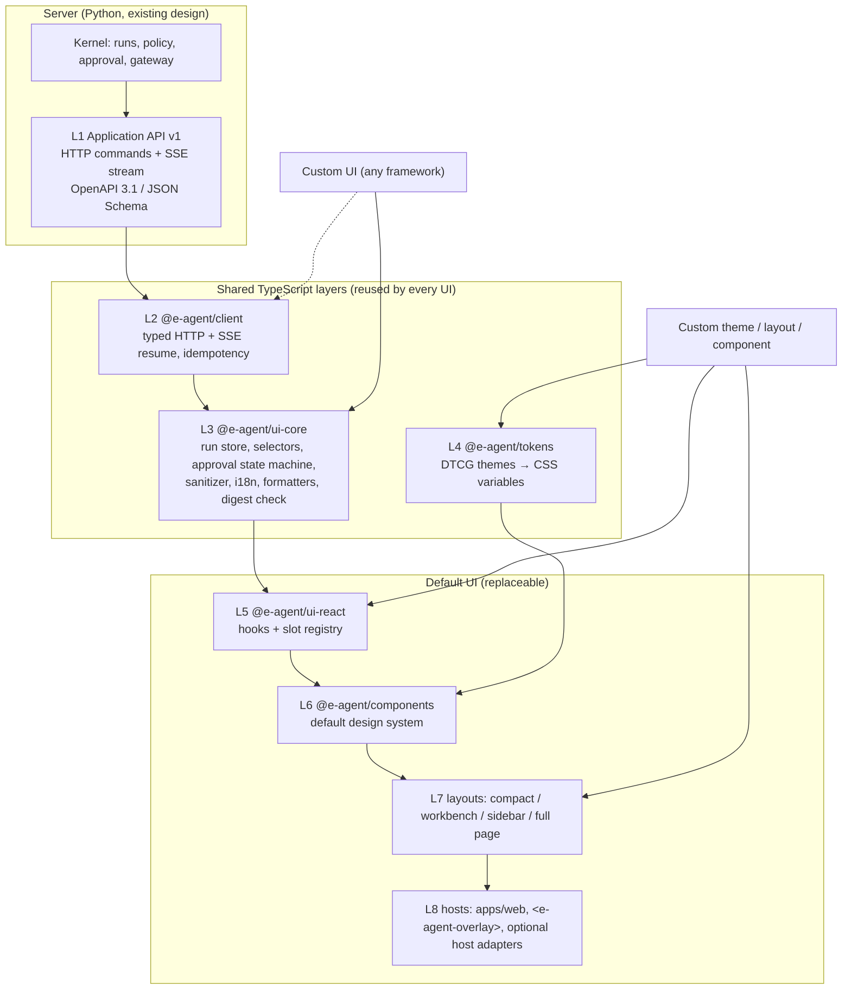

# UI architecture: layered, themeable and replaceable

Implementation clarification (2026-10-07): [ADR 0014](../adr/0014-mvp-remediation-boundaries.md) defines short transactions with work fencing, conservative external uncertainty, approved fact/credential binding and transient public text offsets. These implementation seams require the remediation and live qualification gates; source availability does not establish readiness.
**Date:** 2026-10-08. **Status:** accepted design ([ADR 0011](../adr/0011-layered-replaceable-ui.md), [ADR 0015](../adr/0015-task-workspace-presentation.md), [ADR 0016](../adr/0016-selectable-agent-surfaces.md)); implemented in I08/I09 under `ui/` (see §9 for deviations). It refines the overlay UI that [ADR 0001](../adr/0001-local-mvp-scope.md) puts in the MVP and builds on the stream contract in [ADR 0007](../adr/0007-run-event-stream-contract.md).

## 1. Goal

Planned follow-up (2026-10-08): the [enterprise overlay adoption plan](../../archive/docs/plans/2026-10-08-enterprise-overlay-adoption.md) applies the enterprise-wide mockup within these layers. The [frontend development guide](frontend-development-guide.md) proposes internal feature folders and reuse conventions. These are implementation proposals, not completed changes; new discovery APIs require a focused ADR and affected design updates before implementation.

e-agent ships a **default UI** in two forms: a standalone web app and an embeddable overlay. A deployer must be able to:

1. **re-theme** it (colors, typography, density, light/dark, brand) without code;
2. **re-layout** it (floating overlay, docked sidebar, full page; rearrange or hide panels) through configuration;
3. **replace individual components**, such as a different timeline or evidence viewer;
4. **build an entirely different UI**, in any framework,

while **reusing every layer below the one they change**.

**System neutrality.** e-agent is an enterprise agent, not an add-on to any one business system. The default UI runs standalone and can be embedded into *any* web page. No UI layer depends on Odoo or any other provider. Integration with a specific system's UI is an optional **host adapter** at L8, in the same way that Odoo is only a provider adapter on the backend. The core never needs one. No layer may weaken the safety rules. Approval, policy and validation stay on the server, and every UI talks to the same API.

## 2. Research basis (2026-10)

| Finding | Design consequence |
|---|---|
| Headless component libraries separate behaviour from presentation. Zag.js/Ark UI use framework-agnostic state machines; React Aria provides accessible behaviour hooks. | Put UI *behaviour* in a framework-free core and keep presentation swappable. Build default components on an accessible headless primitive library. |
| The W3C Design Tokens Community Group format reached its first stable version, **2025.10**. It supports themes, aliases and multi-brand sets. | Themes are DTCG token files compiled to CSS custom properties. They are not hard-coded CSS. |
| CSS custom properties inherit through Shadow DOM; `::part()` exposes structural styling; React 19 supports custom elements. | The embeddable overlay is a custom element with Shadow DOM isolation. Its public styling API is tokens plus parts. |
| Chat UI kits (e.g. assistant-ui) split primitives, runtime and backend adapters, and offer an "external store" runtime for app-owned state. | Same layering here: the run store is ours, and UI kits are optional at the component layer. |
| AG-UI standardizes agent→UI event streams (about 16 event types, transport-agnostic). A2UI (v0.9, public preview) lets agents send declarative UI from a host-trusted component catalog. MCP Apps render agent UIs in iframes. | None of these becomes the canonical contract (ADR 0007). AG-UI may become an optional outbound adapter. Agent-generated UI (A2UI/MCP Apps) is out of MVP scope and never allowed for approval surfaces. |
| BFF practice: one API per client surface, typed contracts generated from server models (OpenAPI 3.1). | The e-agent server is the single BFF for all UIs. TypeScript types are generated from the Pydantic DTOs, never hand-written. |

## 3. Layers



| Layer | Package | Responsibility | Must not |
|---|---|---|---|
| L1 API | `e-agent-server` | Commands, snapshots, SSE (ADR 0007), `ApprovalPresentation` | Depend on any UI |
| L2 Client | `@e-agent/client` | Generated types; fetch wrapper with auth, correlation and idempotency key; SSE client with `Last-Event-ID` resume, dedup and `snapshot_required` handling; typed errors | Import DOM-rendering or framework code |
| L3 UI core | `@e-agent/ui-core` | Event-sourced **run store** (reducer: events → view state); selectors (timeline, pending approval, evidence, outcome); **approval state machine**; markdown/link **sanitizer** policy; i18n catalogs (vi, en); decimal/currency/date formatters; JCS digest verification (ADR 0006) | Import React or other frameworks; call `fetch` directly (only via L2); contain business rules |
| L4 Tokens | `@e-agent/tokens` | DTCG 2025.10 source; built CSS variables plus TS constants; default `light`, `dark`, `high-contrast` themes | Contain component code |
| L5 React bindings | `@e-agent/ui-react` | Hooks (`useRun`, `useTimeline`, `usePendingApproval`, `useComposer`); **slot registry** for component overrides | Hold state outside L3 |
| L6 Components | `@e-agent/components` | Default accessible components built on headless primitives, styled only via tokens | Read raw API responses; hard-code colors or spacing |
| L7 Layouts | `@e-agent/layouts` | Layout presets composed from named slots | Contain domain logic |
| L8 Hosts | `apps/web`, `@e-agent/overlay-element`, later `@e-agent/admin` ([integration management](integration-management.md)); optional per-system host adapters | Bootstrapping, auth/session bridge, generic `HostContext` hints, CSP | Grant permissions from host context; leak system-specific types into L1–L7 |

Dependency direction is strictly downward (L8 → L1). It is enforced with dependency-cruiser or ESLint boundary rules, the same way import-linter enforces the Python side.

## 4. Key contracts

### 4.1 API and generated types (L1 → L2)

- Pydantic DTOs in `e-agent-contracts` are the single source. CI generates OpenAPI 3.1 and JSON Schema, then generates the TS types. A schema snapshot diff fails CI on unreviewed changes.
- `RunEvent` is a discriminated union on `type`, versioned by `schema_version`. **Forward compatibility:** ui-core shows an unknown event type as a generic "unsupported event" item and re-fetches the run snapshot. It never guesses the event's meaning.
- `GET /v1/runs/{id}` returns a server-side **run snapshot** that is enough to render the full current state. Events are deltas on that snapshot.

### 4.2 `ApprovalPresentation` (server-owned, safety-critical)

All UIs must show the same approval content, so the server produces it:

```text
ApprovalPresentation {
  run_id, action_id, run_revision, digest ("jcs-sha256-v1:…"), expires_at,
  contract_id, binding_id, connection_id, credential_subject,
  canonical_proposal,                 # the exact digest input
  display_title?, expected_effects,
  material_fields: [{path, label?, value, previous_value?, changed,
                     comparison?, proposal_previous_value?}],
  findings: [{rule_id, rule_version, status, message, evidence_ids}]
}
```

The kernel derives titles, labels and field order from the admitted capability input schema. A domain can declare `x-presentation.baseline_reference` for an amendment: exactly one matching host-retained approved fact supplies current values; missing/ambiguous values stay unknown. `comparison` distinguishes current values from a superseded proposal, whose values remain separately inspectable. No canonical argument or digest changes for these display annotations.

ui-core recomputes the JCS digest of `canonical_proposal` and checks the complete, unique displayed values, scope identifiers and expected effects against it. It refuses to enable "Approve" on a mismatch or a non-PASS finding. The approve command sends `action_id`, `digest` and `expected_revision`, and the server revalidates regardless.

### 4.3 Approval state machine (L3)

`idle → reviewing → confirming → submitting → (approved | rejected | stale | expired | error)`. `stale` happens when a new revision or digest arrives while reviewing, and forces re-review. Moving `reviewing → confirming` requires an explicit user action. Keyboard activation needs focus on the control and a confirm step; Enter in the chat composer can never approve.

### 4.4 Slots and layouts (L5–L7)

Named slots: `header`, `navigation`, `composer`, `messages`, `timeline`, `approval`, `evidence`, `outcome`, `connection-status`, `footer`, `task-overview`.

| Layout | Use | Default arrangement |
|---|---|---|
| `overlay` | Floating, expandable panel over any page | Collapsed launcher → nonmodal task panel; bounded scrolling review body and reachable action footer; collapsible evidence/activity |
| `workbench` | Expanded floating enterprise agent workspace | Shared task/review column plus task overview, evidence and activity; stacks at narrow widths |
| `sidebar` | Panel docked to the left or right edge of whatever page it is on (any web app, intranet portal or the standalone app), pushing or overlapping the content | Full-height task panel with the shared review body and collapsible inspectors |
| `full-page` | Standalone web app | Navigation rail, readable task/conversation/decision/result column, contextual evidence/activity inspector; one column on narrow viewports |

The `approval` slot may be overridden only by a component that passes the UI conformance suite (§6). Layouts are configured with a JSON layout config (`{layout, slots: {timeline: {hidden}}, order}`), validated by the shared parser. `order` reorders primary task slots; every primary slot omitted from the order is still appended. Pending approval cannot be hidden.

### 4.5 Theming (L4)

- Token tiers: **primitive** (palette, type scale) → **semantic** (`color.surface`, `color.text.muted`, `color.status.blocked`) → **component** (`approval.border`). Components use only semantic and component tokens.
- A theme is a DTCG file that overrides semantic or component tokens. It compiles to CSS custom properties under `[data-theme="name"]`.
- Safety-signalling tokens (`status.verified/failed/unknown/blocked`, `approval.material-change`) have minimum contrast checks in CI. A theme cannot make them indistinguishable.
- The overlay custom element exposes the tokens as CSS variables plus `::part(panel|launcher|approval|timeline)`. Host-page CSS cannot leak in through the Shadow DOM.

### 4.6 Hosts and embedding (L8)

| Host | Form | Notes |
|---|---|---|
| Standalone | `apps/web` (Vite SPA, `full-page` layout) | Default and reference UI |
| Any web page | `<e-agent-overlay server="…" theme="…" layout="overlay">` custom element, one script bundle | Shadow DOM; same-origin or allowlisted-origin API; no secrets in attributes or URLs |
| Specific system (optional) | A thin **host adapter** for one system, e.g. a browser-extension content script, an intranet portal snippet, or a system-specific plugin such as an Odoo OWL systray item | Mounts the same custom element and translates the page into a generic `HostContext`; nothing else |

The MVP ships only the first two hosts. Host adapters for particular systems are out of MVP scope and need no change to L1–L7 when added later.

### 4.7 Generic host context

A host may tell the agent what the user is looking at. It does so through one provider-neutral, untrusted hint:

```text
HostContext {
  host_kind: "standalone" | "embedded",
  page_url_origin?,                     # origin only, never full URL with tokens
  resource_hints: [{system_hint, resource_type_hint, external_id_hint}],
  locale?, selection_text? (length-limited)
}
```

The server resolves each hint through the **provider adapters' connection mappings**. For example, `system_hint=odoo` + `purchase.order/42` becomes a tenant-scoped `EvidenceRef` only if an authorized connection exists, and is otherwise dropped. Hints never select credentials, never grant access and never bypass scope. They are treated as untrusted content in prompts (threat model T1).

## 5. Customization tiers

| Tier | What changes | Reused layers | Code needed |
|---|---|---|---|
| T1 Theme | Token values | L1–L3, L5–L8 | None (token file) |
| T2 Layout | Layout preset, slot order and visibility | L1–L6 | Config only |
| T3 Component override | One or more slot components | L1–L5, other components, layouts | Small (React) |
| T4 Custom UI | Everything above L3, or above L2 | L1–L3 (or L1–L2) | Full app, any framework |

A T4 UI that uses `ui-core` inherits the run store, approval state machine, sanitizer, i18n and digest check. A T4 UI that uses only `client` must reimplement those, and the conformance suite still applies.

## 6. UI conformance suite

`@e-agent/ui-conformance` is a Playwright suite that runs against any UI URL. A mock server replays recorded event fixtures. Every default or custom UI that offers approval must pass it:

1. The approval surface shows every `material_fields` entry, marks changed fields, and shows rule findings.
2. Approve is disabled on a digest mismatch, after expiry, and while state is `stale`; a new revision forces re-review.
3. Reconnect after a dropped stream yields no gaps or duplicates and no duplicate command.
4. Model text containing remote images or links causes no network request; links show their full URL.
5. Approval requires explicit focus and confirmation; the composer Enter key never approves.
6. An unknown event type leads to a snapshot refresh, not a crash.
7. Vietnamese and English labels render; there are no layout overflows with long Vietnamese strings.
8. Keyboard-only flow and visible focus work (WCAG 2.2 AA target for the default UI).

Passing the suite is a release condition for a UI. It does not replace the server-side checks.

## 6a. Provider neutrality gate

No package under `ui/` may contain provider identifiers (a CI denylist covers `odoo`, `bigquery`, `google`, `salesforce` and similar). Provider names, icons and form fields reach the UI only as manifest data from the server (ADR 0012).

## 7. Explicit non-goals for the MVP

- Agent-generated UI (A2UI, MCP Apps). If added later, the agent may only reference a host-trusted component catalog, and never for approval or policy surfaces.
- Multiple frameworks for the default UI. React is the only default; other frameworks are T4 custom UIs.
- Runtime plugin loading of UI components from untrusted sources (micro-frontends/module federation).
- AG-UI output. This is an optional later adapter on the server (ADR 0007).

## 8. Verification summary

| Gate | Evidence |
|---|---|
| Layer boundaries | dependency-cruiser rules fail on upward or sideways imports; `ui-core` builds and tests with no DOM or React |
| Contract sync | Generated TS types match the committed OpenAPI snapshot; event fixture round-trip |
| Theming | Swapping theme files changes appearance with zero component diff; contrast checks pass |
| Layout | The four presets render from the same component set; layout config schema validated |
| Replaceability | A minimal non-React **reference custom UI** (vanilla TS or Lit, test fixture only) built on `ui-core` passes the conformance suite |
| Embedding | The overlay element works on a test host page whose aggressive global CSS does not change it |

## 9. Implementation notes (I08/I09)

What exists in `ui/` and where it differs from the text above:

- **Packages:** `@e-agent/client`, `ui-core`, `tokens`, `ui-react`, `components`, `layouts`, `overlay-element`, `ui-conformance`; hosts `apps/web` (also serves the neutral `host.html` test page) and `apps/reference-vanilla` (the T4 reference UI). Packages are consumed as TypeScript source inside the workspace; only the three hosts are built.
- **Generated contracts:** `scripts/export_openapi.py` writes `ui/packages/client/openapi.json`; `pnpm gen` regenerates `schema.ts` and the token CSS. CI fails if either is stale.
- **Tokens:** a small in-repo DTCG compiler (`packages/tokens/build.mjs`, aliases and the types we use) replaces Style Dictionary to avoid a build dependency for a few dozen tokens. Contrast gates are Vitest checks over the resolved values.
- **TypeScript 5.9**, not 7: openapi-typescript 7 needs the TypeScript 5 compiler API. Layer rules use dependency-cruiser only (no ESLint yet).
- **Stream resume:** the browser resumes with `Last-Event-ID`; a fresh `EventSource` (after a snapshot or a closed connection) uses `?after_sequence=`, because it cannot set headers. Clients deduplicate by `sequence` and treat a gap like an unknown event: they re-read the snapshot.
- **Approval:** `MaterialField` carries the complete exact argument set, schema labels and either current-baseline or previous-proposal comparison (ADR 0015). Approve focuses the confirmation prompt, not the confirm button, so confirming always needs a separate action. Hiding the `approval` slot is ignored while a decision is pending.
- **Overlay:** React Aria needs its shadow-DOM flag (`enableShadowDOM` from `react-stately/private/flags/flags`, an unstable export; re-check on upgrades) for pointer presses inside the shadow root. The host element resets inherited text properties, because a host page can set them on the element with `!important`. Only `::part(panel)` is exposed so far. The element opens itself once per new pending approval. The `server` attribute exists, but the MVP session cookie is `SameSite=Strict`, so it works only same-origin until allowlisted-origin auth exists.
- **Host context (§4.7):** `POST /v1/runs` accepts `host_context`. `page_url_origin` must be an origin. A hint resolves only when exactly one in-scope connection that this requester can use has `integration_id == system_hint` (and lists the resource type if it restricts resources); every other hint is dropped and counted. The `run.created` event records the resolved hints as untrusted context; `selection_text` is never persisted and is not yet given to the driver. The overlay sends `host_kind=embedded` plus its origin.
- **Not implemented:** host adapters for specific systems (out of MVP scope) and AG-UI output.

## 10. Task workspace implementation (2026-10-08)

The default app starts with a focused task input and hides empty audit/approval panels. Navigation retains up to 20 session-local task references; New task explicitly leaves unfinished work reachable without stopping it. The controller scopes storage to API origin/tenant/principal, preserves failed submissions with a stable request key and returns an admission result so the composer only clears accepted input. No full-history/list service is implemented.

Clarifications and prior answers remain in the conversation; public text streams without announcing the entire paragraph per token. Status copy distinguishes approval recorded, checking a result, verified, failed and unresolved. Outcome fields correlate VERIFIED actions with authoritative reports and COMMITTED receipt references; model prose supplies no verified fields. Evidence has source/time/completeness records with inspectable data and a separate complete authorized audit export, available during review.

Mobile, sidebar and overlay use bounded review-body scrolling with an action footer and disclosures for details. Current implementation uses native disclosures rather than separate sheets/tabs. Light/dark/high-contrast tokens and EN/VI controls are shared. Domain schema labels are currently English; unavailable resource names remain exact references. Human usability/a11y certification, admitted task examples and richer typed/localized source/result projections remain future work. See the [handoff](../handoffs/2026-10-08-ui-redesign.md) for exact checks and screenshots.

### Selectable presentation surfaces

The header View selector offers Compact, Workbench, Docked and (standalone only) Workspace. One controller remains above layout changes, retaining active task, history, exact approval state, locale/theme and the in-memory composer draft. Switching resets an open confirmation to review, restores focus to View and never issues a decision. Overlay Escape backs out of confirmation before minimizing; minimization returns focus to the launcher and keeps a pending-review badge. Validated session-local layout preferences are overridden by explicit URL/element configuration. Embedded preferences are scoped by element ID; distinct IDs isolate multiple instances. Draft text is not persisted across reload.

L3 owns draft state; L5 supplies a narrow presentation context; L6 renders controls/overview; L7 owns layout selection/preferences/focus; L8 constrains embedded modes. Workbench shows only authoritative run state and supported recorded milestones, without generated plans or progress estimates. See [research and visual design](../../research/11-enterprise-agent-overlay-design.md) and [verification/screenshots](../handoffs/2026-10-08-enterprise-overlay.md).

## 11. Enterprise overlay adoption (2026-10-09)

Implemented under the [adoption plan](../../archive/docs/plans/2026-10-08-enterprise-overlay-adoption.md) work packages FE-00 to FE-07 and API-01, with [ADR 0017](../adr/0017-member-discovery-read-models.md) for the new contracts. The layer boundaries, slot names, public exports and approval authority of §3–§5 are unchanged; the §9/§10 notes above still hold.

### Module organization

Each package entry file is now a public surface only; implementations live beside it by concern — `ui-core/selectors/`, `ui-react/{providers,hooks,slots,presentation}/`, `components/{primitives,features/*}/`, `layouts/{config,shared,overlay,sidebar,full-page,presentation}/`. Export and slot inventories are pinned by Vitest so an extraction cannot silently drop a name. dependency-cruiser additionally forbids primitives importing feature hooks or transport, feature-to-feature imports, surface-to-surface imports and deep cross-package paths. Formatting is migrated module by module through `.prettierscope`; `pnpm format:check` gates only the migrated scope.

### Presentation dimensions

Theme, appearance, density and surface are independent. L7 resolves each dimension with the precedence explicit host configuration → scoped session preference → validated default, marks a host-pinned dimension as locked (the UI then offers no control for it), and reports the resolved values to L8 through an `onPresentation` callback. L8 — `apps/web` and `<e-agent-overlay>` — is the only layer that writes `data-theme`, `data-appearance`, `data-density` and `lang` on its document or shadow host; no component inspects its own root node any more. The token compiler emits a delta block per dimension value per theme.

An appearance changes emphasis, shape, scale and motion only, never colour roles the theme defined, so a theme's contrast guarantees cannot be weakened by a variant; the contrast suite checks every theme × appearance combination and both densities. `calm`, `presence` and `operator` ship; `comfortable` and `compact` ship, both above the WCAG 2.2 AA minimum target size.

### Shared task surface and responsive ownership

One `TaskSurface` module decides region membership and order for every placement; a placement chooses only a geometry variant (`page`, `split`, `stack`). L7 measures its own surface with a `ResizeObserver` and publishes a semantic `compact` value through the L5 surface context, replacing the `window.innerWidth` and ancestor queries that components used. A new proposal is brought into view once in every placement, honouring `prefers-reduced-motion`, and never takes focus.

### Standalone routes

`apps/web` adds validated hash routes — `#/overview`, `#/connections` (shown as Capabilities), `#/task[/<runId>]` — (`#/work` was removed on 2026-10-12 and now falls back to the overview) with an explicit fallback for anything unknown, including malformed percent-encoding. The controller is created above the router and never remounted, so navigation issues no run or command and preserves the active run, the submission identity and the draft. A host-supplied page body is honoured on the standalone surface only, and only while no decision is outstanding, so navigating can never move a pending review out of reach.

Ownership between the address and the controller is explicit, because the obvious "reconcile them on every render" rule is wrong in both directions. A requested run id is a navigation request acted on **once per navigation**: the controller attaches, re-reads the run and applies its safeguards, and the result is `attached` or a terminal `unavailable` state that is never retried — a missing or denied run makes the controller detach, which would otherwise keep the reconcile condition true forever. In the other direction, once an address has settled as attached, **the address follows the controller**: a deliberate detach or a different task chosen from history moves the route (replacing the history entry) instead of the stale address undoing the user's action. The route is the only place that attaches; pages navigate and nothing else.

### Member discovery projections

`GET /v1/me/connections` and `GET /v1/me/task-catalog` (ADR 0017) are read-only projections assembled from admitted metadata and authorized with the same `ConnectionCatalog.usable` rule execution uses. Availability is decided by calling the host's own resolution rules — `PluginRegistry.resolve`, `executor_for`, and `verifier_for` for answers — and reporting their refusal, so the catalog cannot promise what the coordinator would reject; no execution rule is relaxed to make a catalog claim true. The browser validates the `schema_version` envelope *and* the payload shape at the client/core boundary and maps it with pure functions; loading, empty, denied, unsupported, malformed and error are distinct states. A declared version that is not honoured is malformed rather than an empty inventory, one malformed entry fails the whole response instead of quietly shortening it, and the Connections section is hidden only when the workspace does not provide the view at all. Observed health is always unknown because rendering performs no provider probe, and the view offers no connect, re-authorize or repair control because no API implements one.

### Still not implemented

A durable cross-session or tenant-wide work/review inbox, a pending-review count for other people's work, proposal editing, administrative connection management, delegated OAuth, icon or manifest asset delivery, and cross-origin embedding. A development-only component gallery (`pnpm --dir ui gallery`) documents the primitives; it is excluded from every production build.

### Visual foundation adoption (2026-10-12)

Results: [handoff](../handoffs/2026-10-12-ui-foundation-adoption-results.md). Review: [UX review](../reviews/2026-10-12-ui-adoption-ux-review.md). These changes add public exports; the layer boundaries are unchanged.

- `@e-agent/components` exports `BrandMark`, the owner-approved product mark as one pinned SVG. It is decorative (`aria-hidden`) and never recoloured per theme.
- `@e-agent/ui-core` exports `runStatusKey(state, actions)` and `actionStatusKey(state)`. While a run is in flight, the run-status label names a change the server reports as sending, recorded or unconfirmed. These helpers are pure label mappings over server states; the browser never infers or promotes a phase.
- Forced colours (`@media (forced-colors: active)`) are handled in `components.css` and asserted in `forced-colors.spec.ts`.

### Owner review rework, slice 1 (2026-10-12)

Plan: [UI rework 2](../../archive/docs/superpowers/plans/2026-10-12-ui-rework-2.md).

- **Task status.** The status (`RunStatus`: `run-state`, the polite live region, and Stop) sits above the composer. The header carries only product identity, stream state and preferences.
- **Composer.** A Context panel (`ContextPreview`) shows exactly what `RunController.hostContextPreview()` returns. This is the same source `start()` sends, and the panel says so when it is nothing.
- **Overview.** Only the composer, a one-line AI disclosure with details on demand, and recent prompts. A recent prompt only refills the composer.
- **Capabilities.** The task catalog (or the installed-scope statement) moves to the Capabilities page, above the connections. Session work is removed: the sidebar's Recent tasks list opens a task through the route (`TaskNavigation onOpen`), so the route stays the one place that attaches.
- **Inspector.** It is 23rem wide with body-size type. The timeline shows state changes with localised labels (`TimelineItem.transition`) and a time of day (`formatTime`), with the full date in a title.

## 12. Conversation threads (2026-10-22)

Decision: [ADR 0034](../adr/0034-conversation-workspace-and-explanation-ui.md), built to the owner-selected mockup variant A1 (`research/mockups/conversation-thread-v1/`, gates G-B 2026-10-21 and G-C 2026-10-22). Plan: [Phase 4](../plans/2026-10-20-phase4-conversation-chat.md), task 4e.4. Everything below applies only when the server reports `features.conversations: on`. `off`, and `shadow`'s per-run view, keep the per-run view described in §10 and §11 unchanged, with the composer locked as before.

**State and ownership.**

- **L3 (`ui-core`).** The pure selectors live in `selectors/thread.ts`:
  - `isConversationsOn`;
  - `selectThreadShown`: the thread view, unless the open run belongs to no conversation;
  - `selectStopControl`: `active`, `idle` or `unconfirmed`;
  - `isLiveEntry` and `threadRunStatusKey`;
  - `selectRunLine`: the card's one result line, which is the last outcome, else the last supported event;
  - `selectReadConnections`: the connection ids that the server recorded on reads.

  The thread itself is `selectThread` (task 4e.3). The browser infers no run, message or status that the server did not send.
- **L6 (`components`).**
  - `Messages` renders `Thread` in thread mode and today's view otherwise.
  - `TaskNavigation` lists the server's conversations, plus a separate "last seen" group for this session's runs that belong to no conversation.
  - `Composer` holds the refusal hint (`RefusalHint`) above the kept draft and the stop slot (`StopSlot`) below it.
  - The `Header` leaves the stream status to the thread head.
- **One owner for the workspace state.**
  - The open workspace (which run, and the control that opened it) has one owner: the L7 `Layout`, above the surface swap, so it survives a change of placement.
  - The context (`ArtifactWorkspaceProvider`, `useArtifactWorkspace`) is exported from `components`, because run cards (L6) open the workspace and L6 cannot import L7.
  - The focus hand-off (`workspaceFocus.ts`) is internal to `layouts`.

**Geometry.**

- `TaskSurface` renders `ThreadSurface` for every placement. The placement only picks the landmark.
- The thread measures its own width in rem (a container query and `useContainerWidth`, both at **60rem**), so the layout holds at 200 % text (AG-FE-6, AG-A11Y-3).
- **At 60rem and wider,** the artifact workspace sits beside the thread at about 40 % (`clamp(22rem, 40%, 34rem)`). It opens by itself, once each, for a new decision or a result, without moving focus (G-B 6).
- **Narrower,** an open workspace replaces the thread as a full view with "Back to conversation", and it opens only from a run card.

**Workspace.**

- `ArtifactWorkspace` is a labelled `aside` with React Aria tabs (APG): Decision, Result, Sources and Activity. They hold today's slots unchanged, so the approval card keeps its fields, checks and confirm step (ADR 0034 §5 deferred).
- Sources shows the connections recorded on reads, with the acting identity when `/v1/me/connections` discloses it.
- An earlier run shows only its recorded activity, because that is the only thing read for it.
- Escape backs out of an open confirmation first, then closes. Closing returns focus to the opening control.
- When the workspace is closed, the run card and the stop slot carry the status (EA-10).

**Composer and stop.**

- In `on` the composer keeps no local lock, and its input stays enabled while a message is sent, so focus stays in it. A refused message shows the server's hint inside the composer above the kept draft, and the approval card does not change (G-B 4).
- Stop is enabled only while the latest run is active. Otherwise it stays in place, disabled, with its reason. While the result is unconfirmed it offers the safe status check instead (EA-4).
- A new run and run-state changes are announced in one polite region, and focus does not move (EA-16).

**Phase 3 events.** These rules keep `lastSequence` advancing and keep the unknown-event state for genuinely unknown types:

- `context.assembled`, `context.compared`, `repeat.compared` and `grounding.compared`, and each `*.shadow_failed` of these, are known but hidden. They are internal records that do not change the run, like the `conversation.*` records.
- `context.failed` is a labelled timeline row with its `reason_code`, like `feature.fallback`.

**Verification.**

- `ui-conformance/tests/conversation.spec.ts` covers each claim above on the conformance mock, across the four ADR 0016 surfaces.
- An axe check runs per state: WCAG 2.2 AA tags, failing when no rule ran (PR-31).
- The repository does not carry axe-core yet, because adding it needs a lockfile change. The axe states run when `AXE_CORE_PATH` names a local `axe.min.js`, and are skipped with that reason otherwise.
- Browser checks prove mechanics, not design quality or usability. No assistive-technology or user testing was done.
